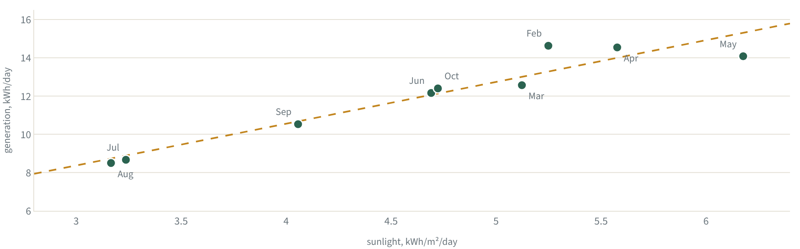

# Reading a rooftop against the sky

[](https://github.com/piyushdash94/rooftop-solar-analytics/actions)
[](https://piyushdash94.github.io/rooftop-solar-analytics/)
[](https://www.python.org/downloads/)
[](LICENSE)

A 3 kWp bifacial solar array went up on a family roof in Bhubaneswar, India, in February 2026.
There is no inverter app and no hardware logging, only monthly electricity bills. This project
joins those bills to free NASA satellite weather and asks three questions. Is the system
working as it should? Why did the bills go up when the panels were new? What will it make
next year?

**[Read the article](https://piyushdash94.github.io/rooftop-solar-analytics/)** (interactive charts) ·
[PDF](article/rooftop-solar-article.pdf) · [Blog version](article/blog.md) · `streamlit run app/streamlit_app.py`

Data: nine TPCODL bills, 8 February to 1 November 2026 (267 days, through the October bill).

---

## What the data says

| Question | Answer |
|---|---|
| What drives output? | **Sunlight explains 91%** of month-to-month generation. Adding temperature or rain made held-out predictions worse, so the model stayed simple. |
| Can it forecast? | The forecast published before October's bill said **389 kWh; the meter read 384 (−1.1%)**. Across all months, holding each out in turn, the typical miss is about 5%. |
| Is the system healthy? | Yes. Against a physics model, only **March (−7%) and May (−8%)** fall short. March was mostly weather. May is heat or dust; monthly bills cannot separate the two. |
| Why did bills rise? | **Demand rose 75% per day** from February to June (20 → 35 kWh/day) as cooling load grew. Generation did not fall. |
| What will a year bring? | About **4,520 kWh** in a typical year, and 4,250–4,650 across the last ten years of weather. 2026 is a poor guide: July and August were 20–22% darker than normal, the darkest in ten years. |
| What has it saved? | **₹19,926** so far. Generation equals 46% of household demand on the bill; 26% of demand was met directly by the panels at the moment they produced. |
| Would a white roof help? | About **+506 kWh a year** (+11%), payback 2.5–3.7 years, modelled. It adds light, not cooling: the panels end up about 1.3–2.6 °C warmer, which costs 16–36 kWh of the gain. |
| Is the sky changing? | Since 1984, sunlight at this location has fallen 0.15 kWh/m² per day per decade. At this grid cell the decline is in the clear-sky component, consistent with aerosols. |



---

## How it works

```
bills.csv + meter_readings.csv ─┐
                                ├─► physics.py ─► story.py ─► figures.py ─► build_article.py
NASA POWER weather (cached CSV) ┘   sunlight on     every       every       HTML · PDF · blog
                                    the panels      number      chart       + Streamlit app
```

1. **Reconcile the bills.** Every billing period is checked against cumulative meter readings.
   This caught a print defect on the July bill (export printed as 204.10 kWh; the meter says
   102.05). The energy charge used the right figure, so it was not an under-billing.
2. **Fetch the weather.** Daily sunlight, temperature and rain for the site's coordinates from
   [NASA POWER](https://power.larc.nasa.gov/): free, no key, cached in `data/raw/` so every
   result reproduces offline.
3. **Model generation two ways.**
   - *Sunlight line:* generation per day = 2.18 × sunlight + 1.82 (R² 0.91). One input, two
     fitted numbers.
   - *Physics model:* sunlight on the 12° panel plane × heat loss × 3 kWp × one fitted
     efficiency. Its held-out miss is 4.7% against the line's 5.2%, too close to rank with nine
     months, but it also explains *why* a month over- or under-delivered. It is also the model run over ten years of historical
     weather for the typical-year forecast.
4. **Choose features by test, not by hunch.** Each candidate model is fitted on all months but
   one and asked to predict the one left out, for every month in turn (leave-one-out). Only what improved
   those held-out predictions stayed.
5. **Write once, render everywhere.** `story.compute()` produces every number and
   `figures.py` every chart. The prose in `article/article.md` uses placeholders like
   `[[fc_total]]`, so the text and the charts cannot disagree.

**Data gets revised.** NASA revised July 2026 sunlight up ~5% and August ~9% after first
release. That erased what had looked like monsoon over-delivery, so the latest months are
always re-downloaded before a new bill is analysed.

**Measured vs modelled.** Generation, import and export are metered. Weather is satellite
estimates. The white-roof gain and its heat effect are modelled from the module datasheet and
published field tests, not measured on this roof. The article labels each.

---

## Run it

```bash
pip install -e ".[dev,app,article]"
python scripts/build_article.py      # site/index.html, article/blog.md, PDF, figures, FINDINGS.md
streamlit run app/streamlit_app.py   # interactive version with adjustable assumptions
pytest                               # 31 tests, offline
```

The PDF and PNG charts need a Chromium browser (`playwright install chromium`).

### Add a new bill

1. Append the three cumulative meter readings to `data/meter_readings.csv` and one row to
   `data/bills.csv`. If the house stood empty, add a row to `data/occupancy.csv`.
2. Refresh the weather: `python -m solar_analytics.weather 2026-02-08 <bill end date>`.
3. `pytest`, then `python scripts/build_article.py`.

The numbers update themselves. If a conclusion changes, `tests/test_story.py` fails and says
which one, so the prose gets rewritten rather than going stale.

---

## Layout

```
data/                    bills, meter readings, occupancy; data/raw/ holds NASA POWER weather
src/solar_analytics/
  config.py              site, module and tariff facts (the only place they live)
  loaders.py             read and reconcile bills
  physics.py             weather → sunlight on the panels → heat loss → expected energy
  story.py               every number in the article
  figures.py             every chart (Plotly)
  weather.py             refresh the cached NASA POWER data
article/                 article.md (source), references.json, generated blog, PDF, figures
app/streamlit_app.py     interactive companion
scripts/build_article.py renders the article in all formats
site/index.html          the published article (GitHub Pages)
tests/                   bill reconciliation, article conclusions, published page
```

## Tech stack

Python · pandas, NumPy, SciPy · pvlib (solar position, clear-sky model) · Plotly ·
Streamlit · Playwright (PDF) · pytest, ruff · GitHub Actions and GitHub Pages.

## Sources

- **Bills:** TP Central Odisha Distribution Ltd (TPCODL), hand-transcribed.
- **Weather:** NASA POWER daily and monthly API. Sunlight from CERES satellite products,
  temperature and rain from MERRA-2.
- **Module:** Waaree Elite N-type BiN-01 bifacial datasheet.
- **Literature:** 18 papers and documents, cited in the article and listed in
  `article/references.json`.

## License

MIT. The data describes one household's meter; the method is the point.
