# Reading a rooftop against the sky

*Nine months of electricity bills, ten years of satellite weather, and what they say about one bifacial solar array in Bhubaneswar.*

By Piyush Dash · November 2026

In February 2026 a 3 kWp array of bifacial panels went up on the roof of our family home in Satya Vihar, Bhubaneswar. Eight months later we had a folder of bills and a few questions that sounded simple. Is the system working as it should? Why did the bills go up when the panels were new? What will it make next year?

**The data.** Nine monthly TPCODL bills, 8 February 2026 to 31 October 2026, each listing cumulative readings from the solar generation meter and the import–export net meter; a month's units are the difference between two consecutive readings. Later we added 263 days of daily import and export from the utility's consumer portal.

We had no inverter app logging output minute by minute, only those numbers. This piece is about how far they can go once you join them to the weather, and about the hunches we had to test, drop or keep along the way.

- **3,181 kWh** generated over 266 days, 8 February 2026 to 31 October 2026.
- **93%** of the month-to-month variation is explained by sunlight alone.
- **−1.1%** miss against the October forecast we published before the bill arrived. Its typical miss across all months is about 5%.
- **4,544 kWh** expected in a typical weather year. The last ten years of weather range from 4,279 to 4,671.
- **₹19,926** saved on bills so far.
- **+509 kWh** a year, modelled, if the roof under the panels is painted white.

## Hunch one: the sun does nearly all the work

The first hunch was the obvious one: more sun, more power. To test it we needed the sunlight that fell on this roof on each billed day. Bills do not carry that, so we took it from NASA's POWER service [1]. For any latitude and longitude, POWER returns a daily estimate of the solar energy reaching a horizontal surface at the ground, in kilowatt-hours per square metre per day (the parameter called ALLSKY_SFC_SW_DWN). The estimate comes from satellite measurements of clouds and the atmosphere, processed by NASA's CERES programme on a grid of 1° by 1°, about 110 km on a side. Air temperature and rainfall come from NASA's MERRA-2 reanalysis on a finer grid. We requested daily values for 20.312° N, 85.868° E through the POWER web API; it is free, needs no key, and runs a few days behind real time.

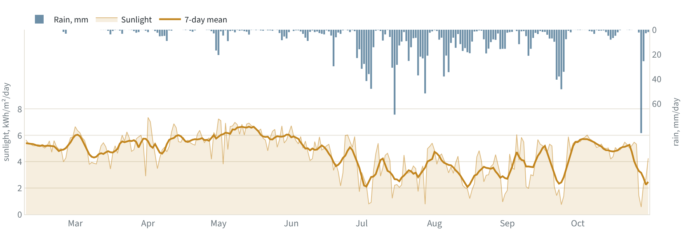

*Daily sunlight (left axis, with its 7-day mean) and rainfall (right axis, hanging from the top) for every billed day. NASA POWER, at the roof's coordinates.*

The shape of the year is plain. Through spring the roof received 5 to 6 kWh of sunlight per square metre each day. Rain builds from the second week of June, and by July the daily average was close to 3.

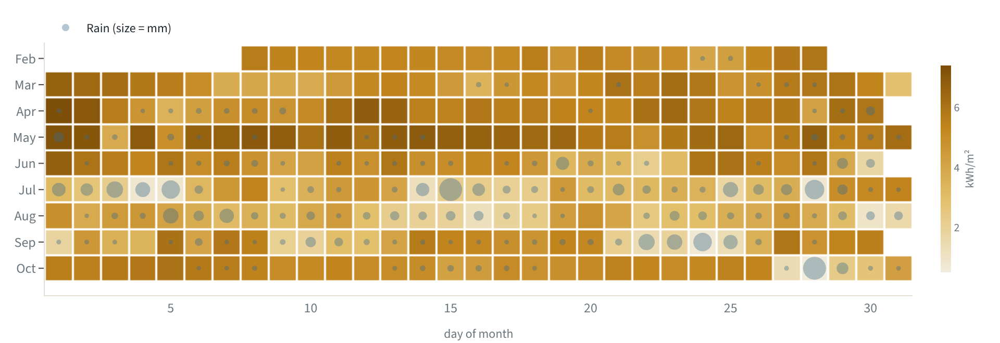

*Each cell is one day: deeper colour means more sunlight; blue dots mark rain, sized by millimetres. The monsoon arrives as a run of pale cells from mid-June.*

Each billing month then becomes two numbers. **Generation per day** is the month's metered generation divided by the number of days in the billing period. **Sunlight per day** is the average of NASA's daily values over exactly the same dates. For the first bill, that is 321.9 kWh over 23 days, or 14.0 kWh a day, against an average of 5.30 kWh/m² of sunlight a day. Dividing by days matters because billing periods run from 23 to 31 days.

Plotted month by month, the two move together almost in a straight line.

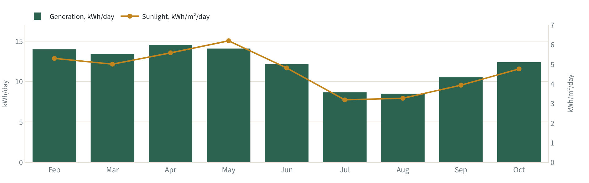

*Bars: each billing month's generation ÷ its number of days. Line: NASA's daily sunlight averaged over the same days.*

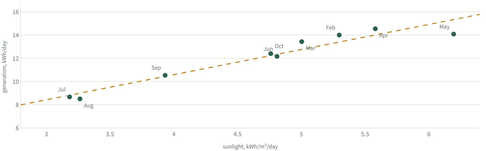

*Each dot is one billing month. The dashed line is the least-squares fit: generation per day = a × sunlight + b.*

    generation per day = 2.17 × sunlight + 1.92
    (generation in kWh/day; sunlight in kWh per m² per day)

Sunlight accounts for 93% of the variation between months (R² = 0.93). Everything else, including dust, heat, shading and power cuts, has to fit in the remaining 7%.

## The bills had the wrong dates

The utility's consumer portal offers daily import and export for the net meter, though not for generation. We downloaded it for every month to see whether it agreed with the bills. Our hunch was that it would, and the only question was how closely.

Summed over the dates printed on each bill, it did not. March was 7% off, and February nearly as much. Moving the windows by a day or two closed the gap completely. On the corrected dates, every complete billing period matches the bill to within 0.01 kWh, on import and export separately. The meter had been read on different days from the ones the bill prints. The February bill actually covers 23 days, ending on 2 March, and the March bill covers only 29 days, from 3 to 31 March, not 31. From April on, each bill covers one calendar month, a day earlier than printed.

The portal's dates are the ones to trust. Daily export tracks the same day's satellite sunlight much more closely than the day before or after. The generation meter is read on the same visit, and the model fits better on the corrected dates, so we use them throughout. Two things this changed are worth stating now. March, which our first version called a shortfall, is not one: we had divided its output by 31 days instead of 29. And temperature, which earlier looked useless as a predictor, turned out to matter.

## What the daily data can and cannot check

The portal gives daily import and export but not daily generation. Export is what the panels made minus what the house used while the sun was up. If our model's day-by-day estimate of generation is right, daily export should rise and fall with it.

It does. Within each month, the model's daily generation explains 44% of the day-to-day swings in export, after allowing for the extra daytime use on hot days. Spreading each month's generation evenly over its days explains 0%. On only 1 of 262 days does the house export more than the model says the panels made, which would be impossible; that was a dark, rainy day, and by less than a kilowatt-hour. The satellite's day-by-day sunlight carries real information about this roof.

Two limits. Each extra kilowatt-hour of modelled generation shows up as only 0.54 kWh of extra export. Part of that is error in single-day satellite estimates, which always shrinks a fitted slope. Part may be the house using more solar directly on sunny days. Daily totals cannot separate the two. And daily data cannot referee between our models: ground sunlight alone explains 43% of the same swings. The physics model's advantages, panel angle and heat, are seasonal, and comparing days within a month removes the season. The monthly comparison below is where the models differ.

## Choosing what to leave out

A line through nine points is easy to draw and easy to fool yourself with. With so few months, every extra variable is another way to fit noise. So instead of asking which features sounded reasonable, we asked which ones helped predict a month the model had not seen.

The test is called leave-one-out. Fit the model on all months but one, predict the one left out, and repeat for every month. The average miss is the number to beat.

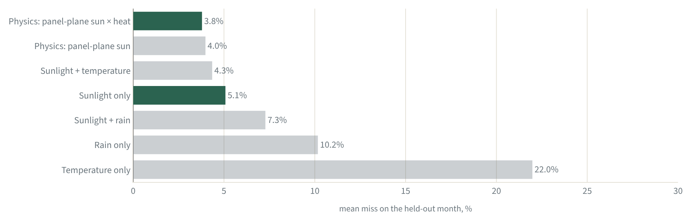

*How far each candidate model missed the one month it was not allowed to see, averaged over all nine months. Green: the two models kept.*

Sunlight alone missed by 5.1% on average. Adding temperature helped, bringing it to 4.3%. Adding rain made it worse, at 7.3%. Rain on its own (10.2%) and temperature on its own (22.0%) were far worse. Rain matters, but its effect is already inside the sunlight number, because rainy days are dull days. Adding it a second time only gives the fit another way to chase noise. Temperature is different: it carries information sunlight does not, because hot cells convert light less efficiently.

On the dates printed on the bills, temperature had looked useless. The two months with the wrong day counts were exactly the ones that hid its effect. That is a small lesson in how one data error can switch a conclusion.

We kept two models. The simple sunlight line is the quick one: one input, two fitted numbers. The physics model described below, which includes heat, misses by 3.8% on average, the best of the set. We use it to judge the panels' health month by month and to forecast winter months the line has never seen.

Every analysis is a list of decisions about what to ignore. Here is ours.

| Feature | Decision | Why |
|---|---|---|
| Sunlight on the ground | Kept | Explains 93% on its own. |
| Panel angle | Simplified | Fixed at the installed 12°, facing south. Used to convert horizontal sunlight into sunlight on the panels. |
| Direct and diffuse light | Simplified | Split with a standard daily formula, because there is no hourly data. |
| Panel temperature | Kept | The datasheet gives a 0.30% loss per °C, and panels run hotter in strong sun. It improved held-out predictions once the billing dates were corrected. |
| Rain | Left out | Its effect is already in sunlight. Adding it worsened predictions. |
| Cloud cover | Left out | Carries the same information as sunlight. |
| Humidity and wind | Left out | No measurable signal at monthly resolution. |
| Dust and soiling | Not modelled | Appears in the residuals instead. |
| Power cuts | Not modelled | No logs. The family estimates about 5 hours a month in daylight. |
| Ground reflectivity | Fixed at 0.12 | Dark concrete. Changed only in the white-paint scenario. |
| Panel ageing | Ignored for 9 months | About 0.4% a year. Included in the lifetime outlook. |
| Who is at home | Demand only | The house was mostly empty for 8 days in May and had guests for 9 days around the start of October, both dated from the daily data. That changes what the house used, never what the panels made. |

## Did the line see the future?

The cleanest test of a model is a month that did not exist when it was built. We published a forecast before October's bill arrived: 389 kWh for a typical October. The meter recorded 384, a miss of −1.1%. The sunlight line, fitted on February to September and given October's measured sunlight, predicted 379 kWh, a miss of +1.5%, well inside its usual scatter of about ±20 kWh for a month that long. September, tested the same way a month earlier, missed by under 4%.

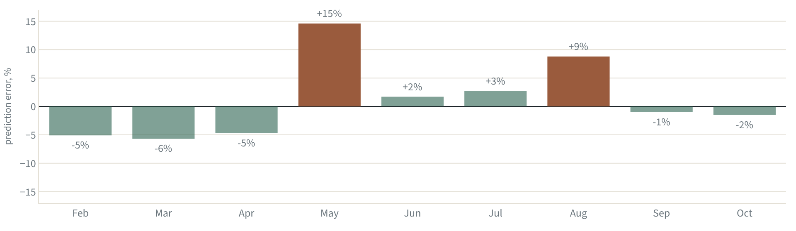

*Fit on all months but one, predict the one left out, repeat for every month. September and October were also genuine out-of-sample tests.*

One good result can be luck, so the leave-one-out chart is the fairer picture. A typical month lands within about 5%. The misses at either end point in opposite directions: February was under-predicted by 5% and May over-predicted by 15%.

**Why February was under-predicted.** The line only knows the sunlight that reaches flat ground. The panels are not flat, and they are not at air temperature. In February the sun stays low in the southern sky, so panels tilted 12° towards it catch it more squarely: they received 7.1% more sunlight than flat ground. In May the sun is almost overhead at noon, and the same tilt costs a little: 2.4% less. February was also cooler (a mean of 24 °C against 32 °C in May), so the cells lost 5.1% of their output to heat against 7.2% in May. Put together, each unit of ground-level sunlight was worth about 12% more electricity in February than in May. That is why the line, which sees only ground sunlight, misses the two months in opposite directions. May's miss is larger than geometry and heat explain, because May is also the one month that genuinely fell short (below). The chart below follows each month from sunlight to kilowatt-hours and shows where the two months part company.

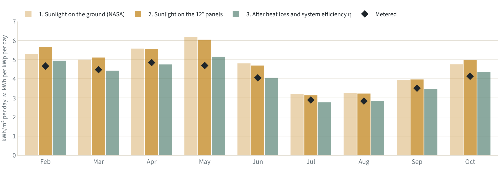

*From sunlight to kilowatt-hours, month by month. Because 1 kWh/m² on the panels gives about 1 kWh per kWp at test conditions, all bars share one scale. Hover for the geometry gain and heat loss.*

## The physics model, input by input

To judge the panels themselves we needed an estimate of what the weather allowed each month, built from physics rather than fitted to the bills. It runs one day at a time and adds the days up for each billing period.

    expected energy = sunlight on the panels × heat derate × 3 kWp × η

**Step 1: sunlight on the panels.** NASA gives sunlight on flat ground. For each day we first compute how much sunlight would arrive at the top of the atmosphere at this latitude on that date; the ratio of the two, the clearness index, says how clear the day was. A standard formula from Erbs, Klein and Duffie [2] turns the clearness index into the share of light that was diffuse, scattered across the sky, rather than direct from the sun. Direct light is then projected onto panels tilted 12° to the south, using the sun's position through the day [3, 4]. Diffuse light is counted from the part of the sky the tilted panels can see [5], and a small amount of light is added for reflection off the roof.

**Step 2: heat.** These modules lose 0.30% of their output for every degree their cells run above 25 °C [6]. Cell temperature is estimated with the datasheet's nominal operating cell temperature (NOCT) of 43 °C, the temperature the cells reach under 800 W/m² of sunlight with the air at 20 °C [6, 4]. Cells warm above the air in proportion to the sunlight on them, so the panels run hot in clear spring weather and stay near air temperature under monsoon cloud.

The temperature we feed in is the air's, not the panels', and it is NASA's 24-hour average, nights included. Nobody measured the panels. The NOCT step converts air temperature to cell temperature, but it starts from a number that is too low for the hours that matter: panels only work in daylight, when the air is warmer than the daily average. NASA's hourly data, weighted by sunlight, puts daytime air about 6 °C above the 24-hour mean in February to April, 5 °C in May and about 2 °C in the monsoon. So the model runs the cells too cool, most of all in the dry months. With daytime air instead, April's heat loss would be 8.8% rather than 7.0%, and July's 4.5% rather than 3.9%. We checked whether that changes any conclusion. It barely does, because the fitted efficiency below absorbs the average bias: no month's residual moves by more than 0.9 points, and May goes from −8.9% to −8.5%, still the only clear shortfall. We kept the daily average so the model matches the ten-year weather files it is run on, and we read the heat-loss percentages in this article as somewhat low. The datasheet's NOCT also assumes a 1 m/s breeze and an open rack. Windier days would cool the panels and a low roof mount would warm them, and without a temperature sensor on the panels we cannot say which wins.

**Step 3: one fitted number.** One kilowatt-hour of sunlight per square metre on the panels would give about one kilowatt-hour per kilowatt-peak at test conditions. Real systems lose some of that in the inverter, the wiring, light reflected off the glass, and dust. We let the data set that single factor, η, as the median of the nine months' metered generation divided by the energy the first two steps predicted. It comes out at 0.919.

| Input | Value | Where it comes from |
|---|---|---|
| Daily sunlight on the ground | kWh/m² per day | NASA POWER [1] |
| Air temperature, 24-hour mean (not panel temperature) | °C | NASA POWER, MERRA-2 [1] |
| Site location | 20.312° N, 85.868° E | The roof's coordinates |
| Panel tilt and direction | 12°, facing south | The installed angle, taken as fixed |
| Ground reflectivity | 0.12 | Assumed for dark, often damp concrete |
| Power loss with temperature | −0.30% per °C | Module datasheet [6] |
| NOCT | 43 °C | Module datasheet [6] |
| Array rating | 3 kWp | The installation |
| System efficiency, η | 0.919 | Fitted: median of metered ÷ predicted over the nine months |

Because η is fitted on the same months the model judges, the model can only compare months with one another. It cannot say how good the system is in absolute terms.

## One month that fell short

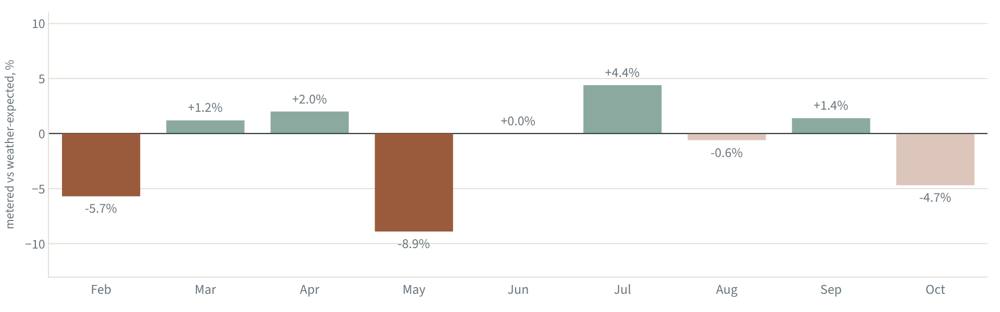

*Metered generation against what the physics model expected from the weather. Hover for the kWh.*

May (−8.9%) is the only clear shortfall. February (−5.7%) is the next lowest, and part of it is the first day: the panels were switched on during 8 February, but the bill counts it as a full day.

March is the story of a hunch that was wrong twice. Early on we flagged it as suspicious, reasoning that March in Odisha is usually drier and sunnier than April. The satellite record said otherwise: March 2026 received less sun than April. That explained most of the gap, and for a while we reported the rest, about 7%, as a real shortfall. The daily data then showed the March bill covered 29 days, not 31. Divided by the right number of days, March comes in at +1.2%. There was nothing wrong with March.

May had the most sun of any month, the highest mean air temperature and the worst conversion, even after the model's heat correction. Heat beyond what the model captures, and pre-monsoon dust, are the candidates. April and June, which followed 75 and 162 mm of rain, both came in above expectation (+2.0% and +0.0%), which fits dust being washed off. But May itself had 59 mm of rain and still fell short, so monthly bills cannot separate the two. The experiment further down tries.

July and August came in at +4.4% and −0.6%, within the model's usual scatter. Our first version showed them 7 to 10% high, and we blamed the daily formula that splits direct from diffuse light under heavy cloud. That explanation was wrong. NASA later revised its July sunlight up by about 5% and August by about 9%, and the excess disappeared. The early satellite estimates had under-read the monsoon.

## An experiment: dust, heat or sky?

Our first look at the residuals, with March and May both short, raised a question. Was it dust on the glass, heat the model under-counts, or something about clear skies? Each explanation leaves its own fingerprint in the data, so each can be tested.

- **Dust.** Dust builds up between rains and washes off in a downpour. For every day we counted the days since the last rain of at least 5 mm, starting from zero on the day the new panels went up, and averaged that over each billing month, giving bright days more weight. Prediction: the longer the dry spell, the lower the residual.
- **Heat.** If the model's heat correction is too gentle, the hottest months will still fall short. Proxy: the modelled cell temperature. Prediction: hotter cells, lower residual.
- **Sky.** If the model treats clear and cloudy days unevenly, the residual will track how clear the sky was. Proxy: the clearness index, measured sunlight ÷ clear-sky sunlight.

We tested each on the 9 months with a rank correlation and an exact permutation test. The test asks how often a random shuffle of the months would give a correlation at least this strong. With nine points, it makes no assumptions we cannot check.

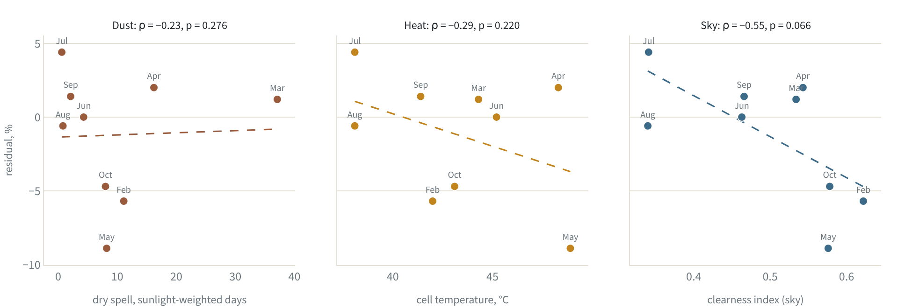

*Each dot is one of the nine discovery months: its residual against a dust proxy (days since rain, weighted by sunlight), cell temperature, and sky clearness. ρ is the rank correlation; p is an exact one-sided permutation test.*

When we first ran this, on the dates printed on the bills, all three looked strong: dust ρ = −0.63, heat −0.66, sky −0.73 (p = 0.016). On the corrected dates most of that evidence goes away. Dust is now ρ = −0.23 (p = 0.276), heat −0.29 (p = 0.220) and sky −0.55 (p = 0.066). After correcting for running three tests (Holm), none comes close to 0.05. Much of the earlier pattern came from March and February's wrong day counts, which happened to line up with the dry, clear, hot season.

The three proxies also travel together. In Bhubaneswar the dry months are the clear months and the hot months. The dust proxy correlates +0.68 with clearness and +0.69 with cell temperature. Holding clearness fixed, the dust correlation shrinks to +0.23. Holding dust fixed, clearness keeps −0.55. With the residuals now small everywhere except May, nine months cannot settle the question.

April and May show the limit. Their cells ran equally hot and their skies were equally clear, yet April came in at +2.0% and May at −8.9%. None of the three proxies separates them, so May's shortfall remains unexplained.

### A forecast to settle it

Winter pulls the three apart. From November to February the sky stays clear, the cells run cool and it rarely rains, so the dry spell grows from about 20 days to about 58. We wrote down a forecast on 8 November 2026, before any winter bill: below −4.7% in December and January would favour dust, above +1.4% heat, anything between sky, with the model's efficiency frozen at 0.9132.

Ten days later the daily data showed those fits were built on the wrong dates. No winter bill had arrived, so we amended the test on 18 November 2026 and kept the original on record. Both will be scored. Feeding the typical winter weather of 2016–2025 into the corrected fits gives these December–January forecasts:

- If **heat** drives the residual, cool winter cells should push it up, to about +3.2%.
- If **dust** drives it, about −0.8%.
- If **sky** drives it, about −2.6%.

*What each explanation predicts for the winter bills, as amended on 18 November 2026 after the billing dates were corrected. Open circles fall outside the range the fit was made on. Shaded: the band where the verdict is 'heat'; below the dotted line, heat is ruled out but dust and sky cannot be told apart. Metered diamonds appear as bills arrive.*

Dust and sky now sit only 1.8 points apart, inside the noise of two months (about ±3.0 points), so the amended test cannot tell them apart and does not try. It asks one question: is it heat? The efficiency is frozen at 0.9186, so new months cannot shift the yardstick. If the December–January average is above +1.2%, the verdict is heat. Below it, heat is ruled out and the cause stays open between dust and sky. A fall of five points or more from November to February still counts for dust on its own, because dust is the only one of the three that builds up month after month. Even this simpler test is weak: there is about a 26% chance of calling heat when it is not, and a 26% chance of missing it when it is. We say so now so that the result cannot be oversold later. The test assumes nobody washes the panels this winter.

## 2026 was not a normal year

Our first projection for the next twelve months simply reused 2026's weather. That turned out to be a mistake worth explaining.

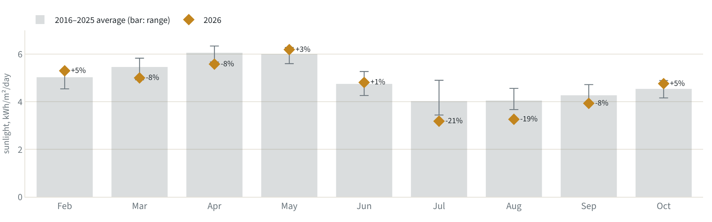

*Sunlight in each 2026 billing month (diamonds) against the same calendar dates in 2016–2025 (bars, with the full range).*

Comparing each billing month with the same calendar dates over the previous ten years shows how unusual 2026 was. July and August received −21% and −19% less sunlight than normal, darker than any of the previous ten years. July's rainfall was 594 mm against a ten-year average of 312 mm. Across the nine billed months, sunlight ran −5% below normal.

NASA revises its most recent months as processing completes. June changed by about 2% between downloads, and July and August by 5 to 9%, so October may still shift. The rainfall, which comes from a separate dataset, tells the same story.

## What a normal year should look like

So instead of projecting from one unusual year, we ran the physics model over every day of the last ten years of weather at the site (2016 to 2025), with η fitted on 2026.

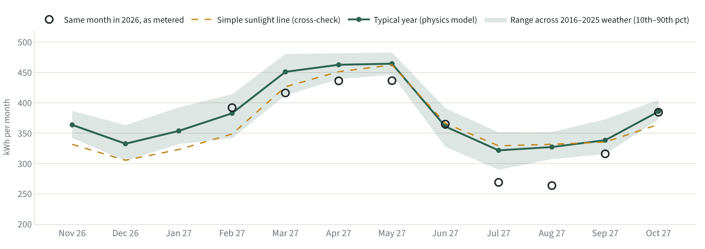

*Expected generation for the next twelve months: the physics model run on each of the last ten years of weather. Open circles show what the same calendar month produced in 2026.*

A typical year comes to about 4,544 kWh for Nov 26 to Oct 27. The simple sunlight line gives 4,375 kWh for the same months, about 4% lower, and most of the gap falls in the low-sun months from October to March. That is the February effect again. In winter the sun is low, and panels tilted towards it collect more than flat-ground sunlight suggests. The line has only seen February to October and has never seen a deep-winter sun. The physics model knows the geometry.

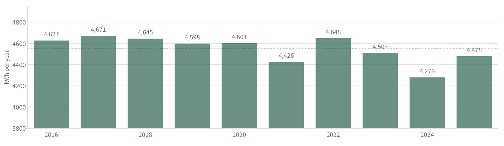

*The same array, run through each of the last ten years of weather. Dotted line: the ten-year average.*

Year to year, the weather moves the total by only 2.7%. The worst of the last ten years, 2024, would have given 4,279 kWh; the best, 2017, 4,671 kWh. A bad year costs a few percent, not a fifth.

## Where the units went, and what they were worth

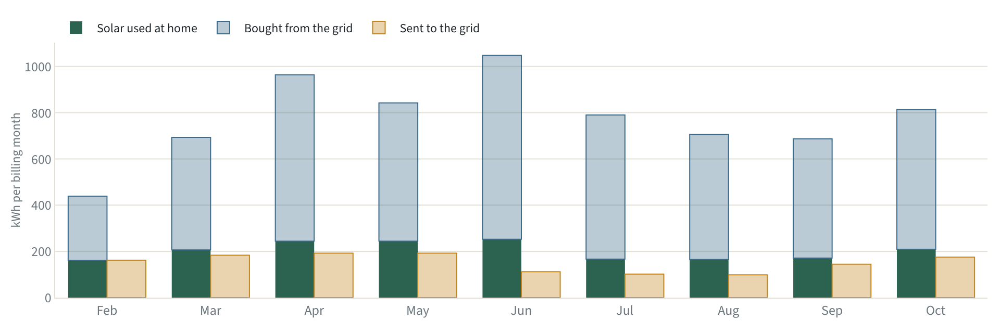

*Each month's household demand (stacked: solar used at home plus electricity bought) beside what was sent back to the grid.*

Solar used at home was steady, at 160 to 253 kWh a month. Demand was not. It rose about 83% per day from February to June (19 to 35 kWh a day) as the air conditioning came on, then eased with the rains. The bills went up because the house used more, not because the panels made less. A 3 kWp system against a 1,000 kWh month is undersized for summer rather than underperforming.

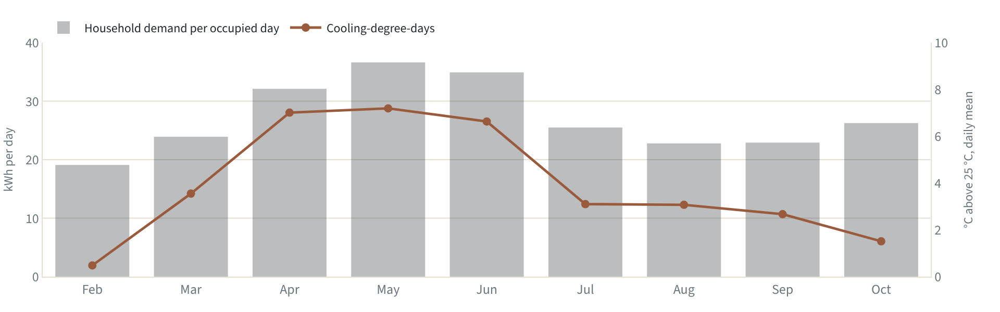

*Household demand per occupied day (bars) and cooling-degree-days (line). May's days are counted net of the week the house stood empty.*

Demand follows the heat. Measured by cooling-degree-days, how far the daily mean temperature sat above 25 °C, the monthly correlation is +0.92, counting May's demand per occupied day because the house was mostly empty for part of it.

The daily data shows the same thing in much finer detail, and it puts dates on the household events the bills could only blur. The portal has no generation, so we spread each month's metered generation across its days in proportion to the physics model's daily estimate. Daily demand is then import plus the solar used at home.

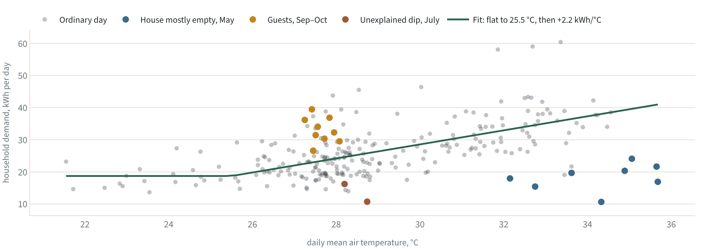

*Each dot is one day: household demand (import + solar used at home) against that day's mean air temperature. Demand is flat until cooling starts, then climbs. Coloured days are the household events; they were left out of the fit.*

Below a daily mean of about 25.5 °C the house uses a steady 19 kWh a day. Above it, each extra degree adds about 2.2 kWh, which is the air conditioning. Temperature explains 42% of the day-to-day variation (R² = 0.42); the rest is ordinary household life, about ±6 kWh a day, with no weekday pattern (the weekday averages differ by at most 1.8 kWh). The threshold confirms the 25 °C base we had assumed for cooling-degree-days.

Measured against that line, the events have sizes:

- **The house mostly empty, 16–23 May.** Demand averaged 18 kWh a day against 38 expected for those hot days, 156 kWh less over the 8 days. Import never fell below 7.5 kWh a day, so the house was not fully empty, which matches the family's description of it as mostly empty that week.
- **Guests, 30 September to 8 October.** About 86 kWh more than the weather predicts, roughly 10 kWh a day. The visit straddled two bills, which is why monthly data could only blur it. October's other days also ran about 3.2 kWh a day above the line, so the guests explain only part of October's rise.
- **10–11 July.** A two-day drop of about 23 kWh that nobody has explained yet.

Daily data can also catch long power cuts: a sunny day with almost no export and lower import. Only 2 September looks like one. The shorter cuts the family remembers, two or three hours every other week, are too small to stand out in daily totals.

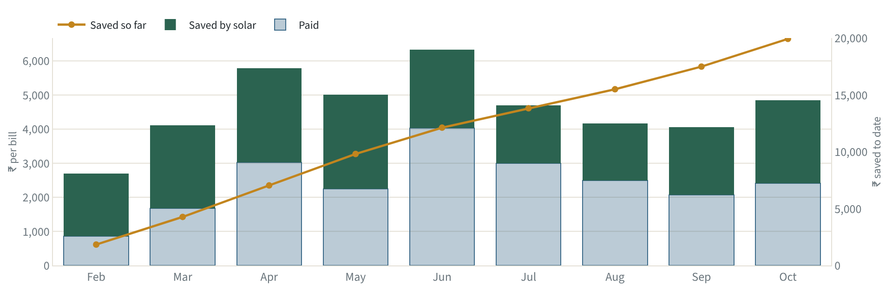

*What each bill cost and what solar saved, slab by slab under net metering, with the running total.*

Under net metering, every exported unit is credited against an imported one, so the bill follows imports minus exports. Comparing each bill with what it would have been without solar, slab by slab at the domestic tariff [7], solar has saved ₹19,926 so far.

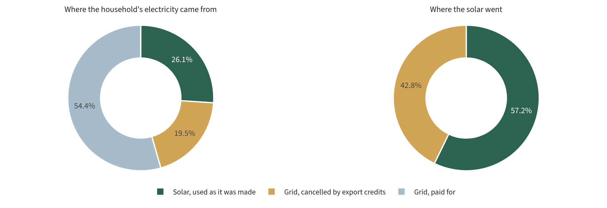

*All nine bills together. Left: bill offset is the green and gold slices together; self-sufficiency is the green slice alone. Right: the same solar, split by where it went.*

Two percentages are easy to confuse, and the left-hand chart shows both. Of all the electricity the house used, 26% came from the panels at the moment they were producing; that green slice is **self-sufficiency**. Another 20% came from the grid but was cancelled on the bill by units the panels had exported earlier; that is the gold slice. Together they make the **bill offset**: generation equal to 46% of household demand. The remaining 54% was bought and paid for. The right-hand chart shows the same solar from the other side: 57% was used at home and 43% went to the grid.

## A cheap experiment: paint the roof white

These panels are bifacial: they collect light on the back as well as the front, from sunlight reflected off the surface below. Today that surface is dark, often damp concrete, which reflects roughly 12% of the light falling on it. White paint reflects about 70%. The module datasheet's rear-gain table runs from 15% to 30% depending on the ground [6], and on the current surface the rear side probably adds about 5%. Our estimate for a white surface is about 12% more light-driven output.

**Would it also keep the panels cooler in summer?** This was worth checking, because heat is what costs these panels most in exactly the months with the highest cooling-degree-days. In a typical year, heat takes 7.4% of output in April, when the cells run about 18 °C above the air, against 2.3% in December.

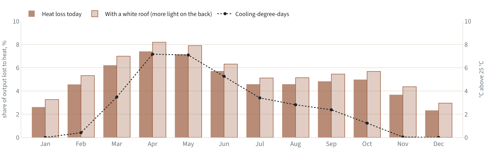

*Share of output lost to panel heat in a typical year, today and with a white roof below, against cooling-degree-days. Hover for how far the cells run above the air.*

Probably not, though the evidence here is thinner than for the light gain. Two effects pull in opposite directions.

- **The back of the panel gets hotter.** Reflected light that reaches the back is absorbed, and absorbed light that does not become electricity becomes heat. With bifaciality of 80% [6], a 12% output gain means about 15% more light landing on the module. In our model, which applies the NOCT relation to that extra light, the cells run about 2.6 °C warmer in April and the heat loss rises from 7.4% to 8.2%. This is a model result, not a measurement.
- **The surroundings get cooler.** A white roof stays cooler in the sun [8], so it radiates less heat at the panels and warms the air around them less. Over a cool-roof coating, monofacial panels, which cannot use the reflected light and so show only this effect, ran 1.3 °C cooler [9].

So at the summer peak the cells end up between 1.3 °C warmer (if the cooling measured on another roof applies here) and 2.6 °C warmer (if it does not). We found no published test that measures bifacial cell temperature over a dark roof and a white one side by side. What the field tests agree on is that the energy gain from a reflective roof comes mostly from extra light, not from lower temperatures [10, 8], and the bifacial gain is much larger than the monofacial one [9]. For this array the paint boosts the light. It is not a coolant.

The heat costs between 16 and 36 kWh a year, depending on which bound holds. Either way that is small next to the 545 kWh of extra light.

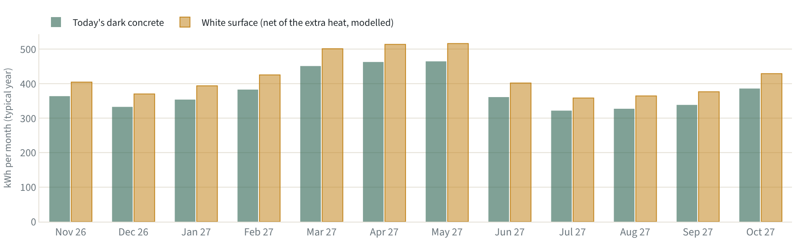

*Typical-year generation with today's dark concrete and with a white surface beneath the panels, after subtracting the extra heat. Modelled from the module datasheet, not measured on this roof.*

Net of that heat, a white surface adds 509 to 530 kWh in a typical year (we use the lower figure), roughly 11%, worth up to ₹3,200 a year at the top tariff slab of ₹6.34 per unit [7]. Winter units fall in cheaper slabs, so treat that as a ceiling. On ₹8,000 to ₹12,000 of paint and labour, the payback is roughly 2.5 to 3.7 years. Paint on the parts of the roof not covered by panels could also keep the rooms below a little cooler in summer [8], but we have no data to put a number on that for this house.

## The sky is getting darker

The last hunch came from a longer view. If sunlight drives everything, is the sunlight itself changing? NASA's record for these coordinates goes back to 1984.

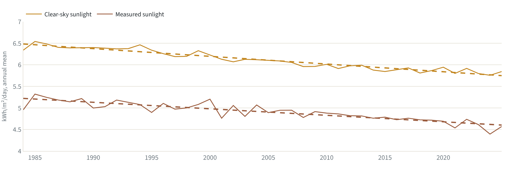

*Annual mean sunlight at these coordinates, 1984–2025: what reached the ground (measured) and what would on a cloudless day (clear-sky). Dashed: trends.*

Average sunlight fell from 5.14 kWh/m² per day in 1984–93 to 4.65 in 2016–25, a decline of −0.15 per decade (p < 0.0001). Ground stations have recorded the same dimming across India for decades [11, 12]. The natural suspect is cloud. But at these coordinates the clear-sky series, the sunlight a cloudless day would deliver, fell even faster, at −0.18 per decade.

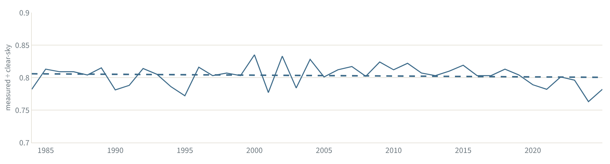

*Clearness index, measured ÷ clear-sky. Flat means cloud cover has not changed.*

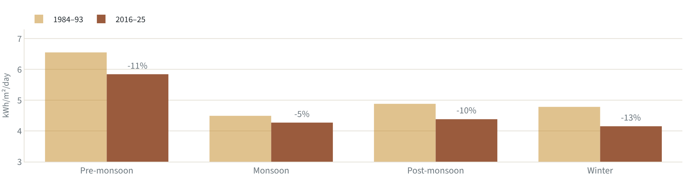

*Seasonal sunlight in the first and the latest decade of the record.*

The clearness index, measured sunlight divided by clear-sky sunlight, is flat (−0.001 per decade, p = 0.53). Over this grid cell, cloud cover has not changed; the air itself has become less transparent. That fits a 2024 study that found clouds dominate dimming across India as a whole, but named the region containing Bhubaneswar as the country's most aerosol-affected [13]. The dry seasons lost the most here, and those are the months in which a rooftop array earns most of its keep.

The same NASA record shows daily maximum temperatures falling, while India's own station network shows them rising [14]. We treat that as an artefact of the dataset and build nothing on it.

## Over the panels' life

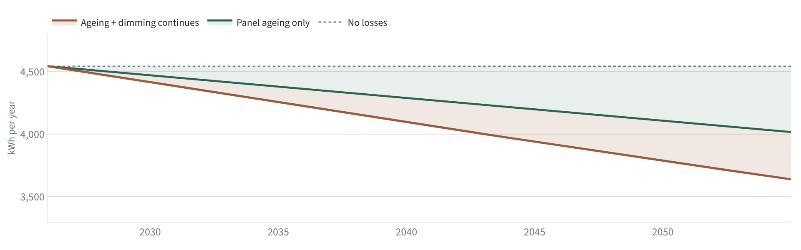

*Annual output over the panels' 30-year power warranty. Ageing follows the datasheet warranty line; dimming extrapolates the 42-year trend, a downside case rather than a forecast.*

Two slow losses compound. The panels age: the datasheet warrants at least 99% of rated power after the first year and 87.4% after 30 years, about 0.4% a year [6]. And if the dimming trend continues at 0.32% a year, sunlight falls further over the same period. By 2055 the array would make about 3,639 kWh, 20% below year one, about 8 percentage points worse than ageing alone. Aerosol pollution is a policy choice rather than a law of nature. Europe has brightened since the 1980s as air pollution was cut [15, 16], and eastern China has brightened since its 2013 Clean Air Action [17], after decades in which pollution had measurably cut solar output [18]. The lower line is a downside case, not a forecast.

## How we worked

- **Data.** Nine TPCODL bills, 8 February 2026 to 31 October 2026, reconciled against cumulative meter readings and against 263 days of daily import and export from the TPCODL portal, which corrected the bills' printed reading dates. NASA POWER daily weather for the billed days, ten years of daily history (2016 to 2025), and the monthly and annual record back to 1984 [1].
- **Model one, for forecasting.** Generation per day = a × sunlight + b, fitted by least squares on the nine months.
- **Model two, for diagnosis and the typical-year forecast.** Sunlight on the panels × heat derate × kWp × η, with η the only fitted number.
- **Validation.** Two genuine out-of-sample months (September, then October against a published forecast) and leave-one-out across all nine. A pre-registered winter test of three explanations for the residuals, amended once before any winter data (and the original kept), scored against a frozen model.
- **Assumptions.** Panels fixed at 12° facing south. Ground reflectivity 0.12. Cell temperature from a NOCT of 43 °C. Tariff slabs of ₹2.90, 4.70, 5.70 and 6.10 per unit plus 4% duty. The house mostly empty for 8 days in May and guests for 9 days in September–October, dated from the daily data (demand only). White-surface gain of 12% from the datasheet's rear-gain table.
- **Limits.** Nine monthly points for generation; daily data covers only import and export. Air temperature is NASA's 24-hour mean, not a panel or daytime reading, so heat losses are somewhat understated. An efficiency fitted on the same months it judges. Satellite estimates for a grid cell rather than a sensor on the roof. No inverter-level data.

Every number and chart in this piece is regenerated from the project's data with a single command.

## Sources

1. NASA Langley Research Center, POWER Project. Data methodology: solar data from CERES SYN1deg and FLASHFlux at 1° × 1°; meteorology from MERRA-2 at ½° × ⅝°. https://power.larc.nasa.gov/docs/methodology/
2. Erbs, D. G., Klein, S. A. & Duffie, J. A. (1982). Estimation of the diffuse radiation fraction for hourly, daily and monthly-average global radiation. Solar Energy 28(4), 293–302. doi:10.1016/0038-092X(82)90302-4 https://doi.org/10.1016/0038-092X(82)90302-4
3. Anderson, K. S. et al. (2023). pvlib python: 2023 project update. Journal of Open Source Software 8(92), 5994 (solar position and Ineichen clear-sky model used here). https://doi.org/10.21105/joss.05994
4. Duffie, J. A. & Beckman, W. A. (2013). Solar Engineering of Thermal Processes, 4th ed. Wiley (extraterrestrial radiation, beam tilt factor, NOCT cell-temperature model). https://doi.org/10.1002/9781118671603
5. Liu, B. Y. H. & Jordan, R. C. (1963). The long-term average performance of flat-plate solar-energy collectors. Solar Energy 7(2), 53–74 (isotropic-sky model for diffuse light on a tilted surface). https://doi.org/10.1016/0038-092X(63)90006-9
6. Waaree Energies. Elite Series N-type BiN-01-555 to BiN-01-585 framed dual-glass bifacial module datasheet (WEL/E&PD/555-585/108/BiN-01/HC/02, 03.01.2025): γ = −0.30 %/°C, NOCT 43 ± 2 °C, bifaciality 80 ± 10 %, backside gain table 15–30 %, 30-year power warranty (99 % after year 1, 87.4 % after year 30). https://rooftopsolarindia.com/datasheet/waaree-energies/datasheet-waaree-elite-n-type-bifacial-555W-560W-565W-570W-575W-580W-585W.pdf
7. Kalinga TV (24 March 2025). No power tariff hike in Odisha for 2025-26: domestic energy charges ₹2.90 (0–50 units), ₹4.70 (51–200), ₹5.70 (201–400), ₹6.10 (above 400). The same slabs appear on the TPCODL bills. https://kalingatv.com/odisha/no-power-tariff-hike-in-odisha-for-2025-26-check-details-rebate-for-e-bill/
8. Experimental energy performance assessment of a bifacial photovoltaic system and effect of cool roof coating. Journal of Building Engineering (2023); summarised in pv magazine, 17 November 2023: bifacial + cool roof +8.6 % vs monofacial; unshaded roof surface −3.8 °C in summer (Barcelona test bench). https://www.pv-magazine.com/2023/11/17/lowering-bifacial-rooftop-pv-system-temperature-with-cool-roof-coating/
9. Mahmood, K., Hussain, A., Arslan, M. & Tariq, B. (2023). Experimental investigation of impact of cool roof coating on bifacial and monofacial photovoltaic modules. Engineering Proceedings 45(1), 38. doi:10.3390/engproc2023045038 https://doi.org/10.3390/engproc2023045038
10. Altan, H. et al. (2019). An experimental study of the impact of cool roof on solar PV electricity generations on building rooftops in Sharjah, UAE. International Journal of Low-Carbon Technologies 14(2), 267–276. https://academic.oup.com/ijlct/article/14/2/267/5307064
11. Padma Kumari, B. et al. (2007). Observational evidence of solar dimming: Offsetting surface warming over India. Geophysical Research Letters. doi:10.1029/2007GL031133 https://doi.org/10.1029/2007GL031133
12. Soni, V. K., Pandithurai, G. & Pai, D. S. (2012). Evaluation of long-term changes of solar radiation in India. International Journal of Climatology. doi:10.1002/joc.2294 https://doi.org/10.1002/joc.2294
13. Jadhav, A. V., Rahul, P. R. C., Kumar, V., Dumka, U. C. & Bhawar, R. L. (2024). Spatiotemporal assessment of surface solar dimming in India: impacts of multi-level clouds and atmospheric aerosols. Climate 12(4), 48. doi:10.3390/cli12040048 https://doi.org/10.3390/cli12040048
14. Kumar, R., Kuttippurath, J., Gopikrishnan, G. S., Kumar, P. & Varikoden, H. (2023). Enhanced surface temperature over India during 1980–2020 and future projections: causal links of the drivers and trends. npj Climate and Atmospheric Science 6, 164 (IMD gridded data: maximum temperature rising 0.14–0.21 °C per decade). https://www.nature.com/articles/s41612-023-00494-0
15. Wild, M. et al. (2005). From dimming to brightening: decadal changes in solar radiation at Earth's surface. Science 308, 847–850. doi:10.1126/science.1103215 https://doi.org/10.1126/science.1103215
16. Wild, M. (2009). Global dimming and brightening: a review. Journal of Geophysical Research 114, D00D16. doi:10.1029/2008JD011470 https://doi.org/10.1029/2008JD011470
17. Shi, H. et al. (2021). Surface brightening in eastern and central China since the implementation of the Clean Air Action in 2013: causes and implications. Geophysical Research Letters. doi:10.1029/2020GL091105 https://doi.org/10.1029/2020GL091105
18. Sweerts, B. et al. (2019). Estimation of losses in solar energy production from air pollution in China since 1960 using surface radiation data. Nature Energy. doi:10.1038/s41560-019-0412-4 https://doi.org/10.1038/s41560-019-0412-4
