# Reading a rooftop against the sky

*Eight months of electricity bills, ten years of satellite weather, and what they say about one bifacial solar array in Bhubaneswar.*

By Piyush Dash · October 2026

In February 2026 a 3 kWp array of bifacial panels went up on the roof of our family home in Satya Vihar, Bhubaneswar. Eight months later we had a folder of bills and a few questions that sounded simple. Is the system working as it should? Why did the bills go up when the panels were new? What will it make next year?

**The data.** Eight monthly TPCODL bills, 8 February 2026 to 1 October 2026, each listing cumulative readings from the solar generation meter and the import–export net meter; a month's units are the difference between two consecutive readings.

We had no inverter app logging output minute by minute, only those monthly numbers. This piece is about how far they can go once you join them to the weather, and about the hunches we had to test, drop or keep along the way.

- **2,797 kWh** generated over 236 days, 8 February 2026 to 1 October 2026.
- **91%** of the month-to-month variation is explained by sunlight alone.
- **−3.4%** miss on a month the model had never seen. Its typical miss across all months is about 5%.
- **4,580 kWh** expected in a typical weather year. The last ten years of weather range from 4,313 to 4,708.
- **₹17,487** saved on bills so far.
- **+513 kWh** a year, modelled, if the roof under the panels is painted white.

## Hunch one: the sun does nearly all the work

The first hunch was the obvious one: more sun, more power. To test it we needed the sunlight that fell on this roof on each billed day. Bills do not carry that, so we took it from NASA's POWER service [1]. For any latitude and longitude, POWER returns a daily estimate of the solar energy reaching a horizontal surface at the ground, in kilowatt-hours per square metre per day (the parameter called ALLSKY_SFC_SW_DWN). The estimate comes from satellite measurements of clouds and the atmosphere, processed by NASA's CERES programme on a grid of 1° by 1°, about 110 km on a side. Air temperature and rainfall come from NASA's MERRA-2 reanalysis on a finer grid. We requested daily values for 20.312° N, 85.868° E through the POWER web API; it is free, needs no key, and runs a few days behind real time.

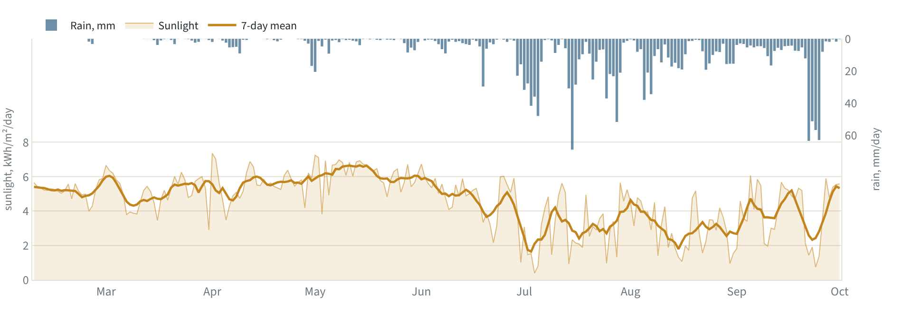

*Daily sunlight (left axis, with its 7-day mean) and rainfall (right axis, hanging from the top) for every billed day. NASA POWER, at the roof's coordinates.*

The shape of the year is plain. Through spring the roof received 5 to 6 kWh of sunlight per square metre each day. Rain builds from the second week of June, and by July the daily average was close to 3.

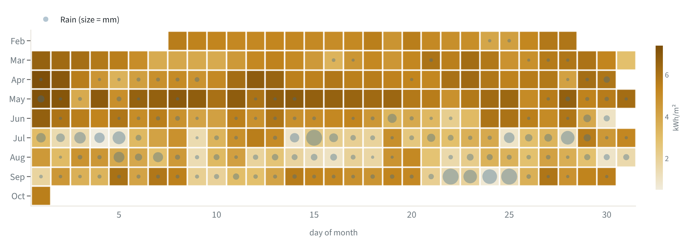

*Each cell is one day: deeper colour means more sunlight; blue dots mark rain, sized by millimetres. The monsoon arrives as a run of pale cells from mid-June.*

Each billing month then becomes two numbers. **Generation per day** is the month's metered generation divided by the number of days in the billing period. **Sunlight per day** is the average of NASA's daily values over exactly the same dates. For the first bill, that is 321.9 kWh over 22 days, or 14.6 kWh a day, against an average of 5.25 kWh/m² of sunlight a day. Dividing by days matters because billing periods run from 22 to 31 days.

Plotted month by month, the two move together almost in a straight line.

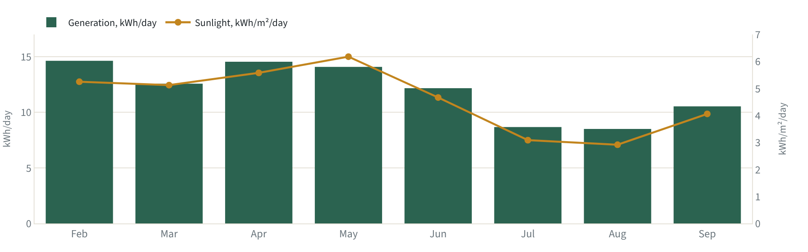

*Bars: each billing month's generation ÷ its number of days. Line: NASA's daily sunlight averaged over the same days.*

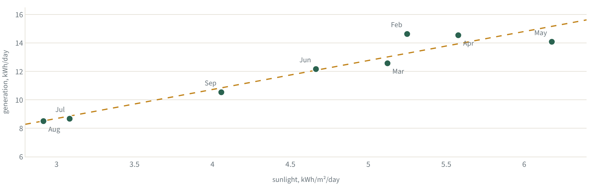

*Each dot is one billing month. The dashed line is the least-squares fit: generation per day = a × sunlight + b.*

    generation per day = 2.04 × sunlight + 2.56
    (generation in kWh/day; sunlight in kWh per m² per day)

Sunlight accounts for 91% of the variation between months (R² = 0.91). Everything else, including dust, heat, shading and power cuts, has to fit in the remaining 9%.

## Choosing what to leave out

A line through eight points is easy to draw and easy to fool yourself with. With so few months, every extra variable is another way to fit noise. So instead of asking which features sounded reasonable, we asked which ones helped predict a month the model had not seen.

The test is called leave-one-out. Fit the model on seven months, predict the eighth, and repeat for every month. The average miss is the number to beat.

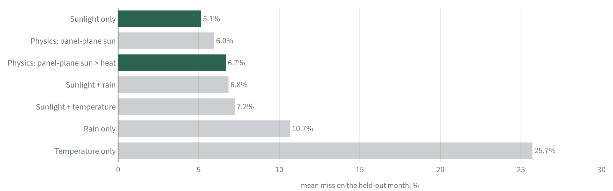

*How far each candidate model missed the one month it was not allowed to see, averaged over all eight months. Green: the two models kept.*

Sunlight alone missed by 5.1% on average. Adding temperature made it worse, at 7.2%, and so did adding rain, at 6.8%. Rain on its own (10.7%) and temperature on its own (25.7%) were far worse. Rain matters, but its effect is already inside the sunlight number, because rainy days are dull days. Adding it a second time only gives the fit another way to chase noise.

We kept two models. The simple sunlight line is the better forecaster at this resolution. The physics model described below misses by 6.7% on average, so we do not keep it for its forecasting record. We keep it because it can do two things the line cannot: judge the panels' health month by month, and forecast winter months the line has never seen.

Every analysis is a list of decisions about what to ignore. Here is ours.

| Feature | Decision | Why |
|---|---|---|
| Sunlight on the ground | Kept | Explains 91% on its own. |
| Panel angle | Simplified | Fixed at the installed 12°, facing south. Used to convert horizontal sunlight into sunlight on the panels. |
| Direct and diffuse light | Simplified | Split with a standard daily formula, because there is no hourly data. |
| Panel temperature | Kept, physics model only | The datasheet gives a 0.30% loss per °C, and panels run hotter in strong sun. Monthly data is too coarse to see it clearly, but physics says it is there. |
| Rain | Left out | Its effect is already in sunlight. Adding it worsened predictions. |
| Cloud cover | Left out | Carries the same information as sunlight. |
| Humidity and wind | Left out | No measurable signal at monthly resolution. |
| Dust and soiling | Not modelled | Appears in the residuals instead. |
| Power cuts | Not modelled | No logs. The family estimates about 5 hours a month in daylight. |
| Ground reflectivity | Fixed at 0.12 | Dark concrete. Changed only in the white-paint scenario. |
| Panel ageing | Ignored for 8 months | About 0.4% a year. Included in the lifetime outlook. |
| Who is at home | Demand only | The house stood empty for about a week in May. That changes what the house used, never what the panels made. |

## Did the line see the future?

The cleanest test of a model is a month that did not exist when it was built. We fitted the line on February to August and waited for September's bill. Given September's measured sunlight, it predicted 327 kWh. The meter recorded 316, a miss of −3.4%, well inside the line's usual scatter of about ±24 kWh for a month that long.

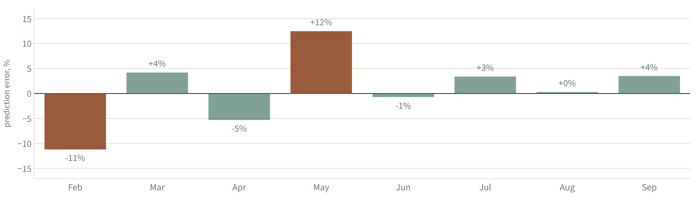

*Fit on seven months, predict the eighth, repeat for every month. September was also the genuine out-of-sample test.*

One good result can be luck, so the leave-one-out chart is the fairer picture. A typical month lands within about 5%. The two worst misses point in opposite directions: February was under-predicted by 11% and May over-predicted by 12%.

**Why February was under-predicted.** The line only knows the sunlight that reaches flat ground. The panels are not flat, and they are not at air temperature. In February the sun stays low in the southern sky, so panels tilted 12° towards it catch it more squarely: they received 7.1% more sunlight than flat ground. In May the sun is almost overhead at noon, and the same tilt costs a little: 2.5% less. February was also cooler (a mean of 24 °C against 32 °C in May), so the cells lost 5.0% of their output to heat against 7.2% in May. Put together, each unit of ground-level sunlight was worth about 12% more electricity in February than in May. That is the size of both misses. The chart below follows each month from sunlight to kilowatt-hours and shows where the two months part company.

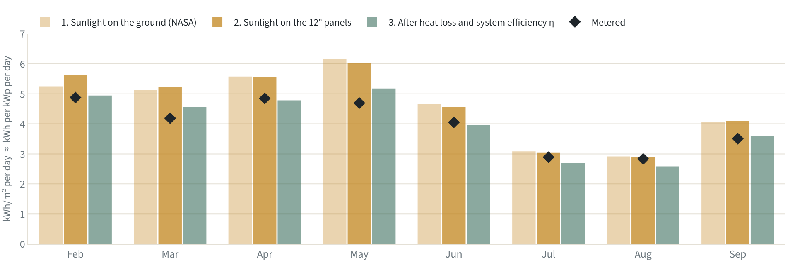

*From sunlight to kilowatt-hours, month by month. Because 1 kWh/m² on the panels gives about 1 kWh per kWp at test conditions, all bars share one scale. Hover for the geometry gain and heat loss.*

## The physics model, input by input

To judge the panels themselves we needed an estimate of what the weather allowed each month, built from physics rather than fitted to the bills. It runs one day at a time and adds the days up for each billing period.

    expected energy = sunlight on the panels × heat derate × 3 kWp × η

**Step 1: sunlight on the panels.** NASA gives sunlight on flat ground. For each day we first compute how much sunlight would arrive at the top of the atmosphere at this latitude on that date; the ratio of the two, the clearness index, says how clear the day was. A standard formula from Erbs, Klein and Duffie [2] turns the clearness index into the share of light that was diffuse, scattered across the sky, rather than direct from the sun. Direct light is then projected onto panels tilted 12° to the south, using the sun's position through the day [3, 4]. Diffuse light is counted from the part of the sky the tilted panels can see [5], and a small amount of light is added for reflection off the roof.

**Step 2: heat.** These modules lose 0.30% of their output for every degree their cells run above 25 °C [6]. Cell temperature is estimated with the datasheet's nominal operating cell temperature (NOCT) of 43 °C, the temperature the cells reach under 800 W/m² of sunlight with the air at 20 °C [6, 4]. Cells warm above the air in proportion to the sunlight on them, so the panels run hot in clear spring weather and stay near air temperature under monsoon cloud.

**Step 3: one fitted number.** One kilowatt-hour of sunlight per square metre on the panels would give about one kilowatt-hour per kilowatt-peak at test conditions. Real systems lose some of that in the inverter, the wiring, light reflected off the glass, and dust. We let the data set that single factor, η, as the median of the eight months' metered generation divided by the energy the first two steps predicted. It comes out at 0.926.

| Input | Value | Where it comes from |
|---|---|---|
| Daily sunlight on the ground | kWh/m² per day | NASA POWER [1] |
| Daily mean air temperature | °C | NASA POWER, MERRA-2 [1] |
| Site location | 20.312° N, 85.868° E | The roof's coordinates |
| Panel tilt and direction | 12°, facing south | The installed angle, taken as fixed |
| Ground reflectivity | 0.12 | Assumed for dark, often damp concrete |
| Power loss with temperature | −0.30% per °C | Module datasheet [6] |
| NOCT | 43 °C | Module datasheet [6] |
| Array rating | 3 kWp | The installation |
| System efficiency, η | 0.926 | Fitted: median of metered ÷ predicted over the eight months |

Because η is fitted on the same months the model judges, the model can only compare months with one another. It cannot say how good the system is in absolute terms.

## Two months that fell short

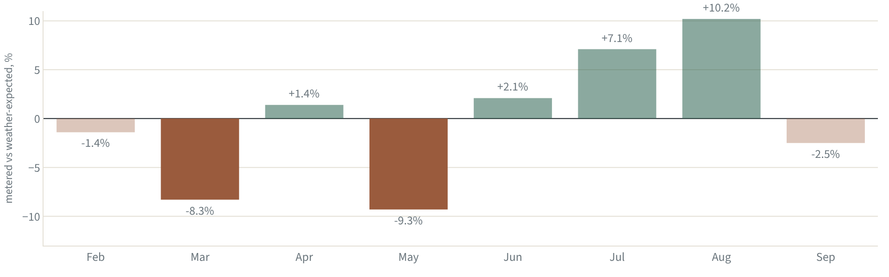

*Metered generation against what the physics model expected from the weather. Hover for the kWh.*

March (−8.3%) and May (−9.3%) are the only real shortfalls.

March is the story of a hunch that was wrong. Early on we flagged it as suspicious, reasoning that March in Odisha is usually drier and sunnier than April. The satellite record said otherwise: March 2026 received less sun than April. Most of March's low output was weather, and only the residual in the chart survived once the weather was accounted for.

May had the most sun of any month, the highest mean air temperature and the worst conversion, even after the model's heat correction. Heat beyond what the model captures, and pre-monsoon dust, are the candidates. April and June, which followed 75 and 162 mm of rain, both recovered to between +1% and +2%, which fits dust being washed off. But May itself had 59 mm of rain and still fell short, so monthly bills cannot separate the two.

July and August came in +7.1% and +10.2% above expectation. Under heavy overcast most light is diffuse, and a daily formula for splitting direct from diffuse light is least reliable there. We treat that as a limit of the method rather than a property of the panels.

## 2026 was not a normal year

Our first projection for the next twelve months simply reused 2026's weather. That turned out to be a mistake worth explaining.

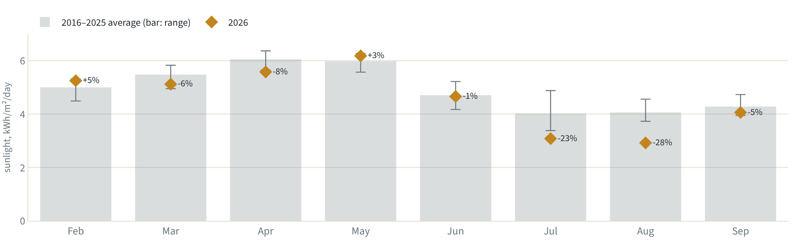

*Sunlight in each 2026 billing month (diamonds) against the same calendar dates in 2016–2025 (bars, with the full range).*

Comparing each billing month with the same calendar dates over the previous ten years shows how unusual 2026 was. July and August received −23% and −28% less sunlight than normal, darker than any of the previous ten years. July's rainfall was 563 mm against a ten-year average of 318 mm. Across the eight billed months, sunlight ran −7% below normal.

NASA revises its most recent months as processing completes. Between our first and second download, June's values changed, so July to September may still shift slightly. The rainfall, which comes from a separate dataset, tells the same story.

## What a normal year should look like

So instead of projecting from one unusual year, we ran the physics model over every day of the last ten years of weather at the site (2016 to 2025), with η fitted on 2026.

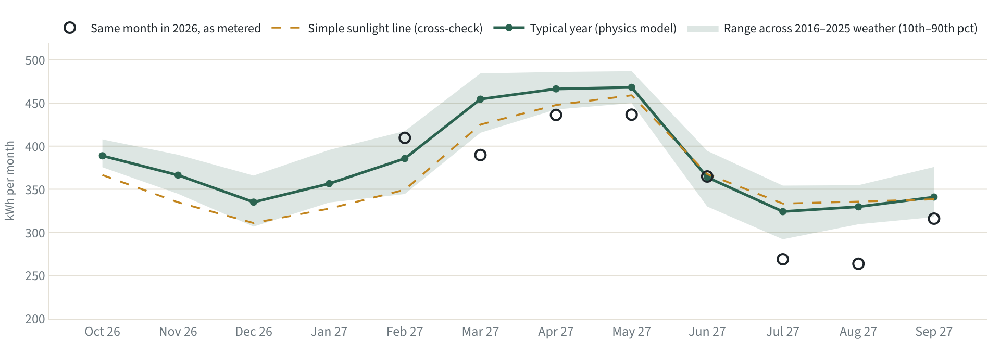

*Expected generation for the next twelve months: the physics model run on each of the last ten years of weather. Open circles show what the same calendar month produced in 2026.*

A typical year comes to about 4,580 kWh for Oct 26 to Sep 27. The simple sunlight line gives 4,396 kWh for the same months, about 4% lower, and most of the gap falls in the low-sun months from October to March. That is the February effect again. In winter the sun is low, and panels tilted towards it collect more than flat-ground sunlight suggests. The line was fitted on February to September and has never seen a winter sun. The physics model knows the geometry.

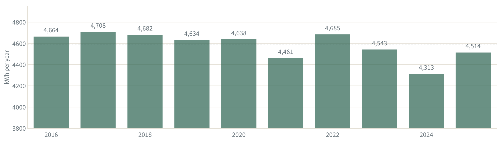

*The same array, run through each of the last ten years of weather. Dotted line: the ten-year average.*

Year to year, the weather moves the total by only 2.7%. The worst of the last ten years, 2024, would have given 4,313 kWh; the best, 2017, 4,708 kWh. A bad year costs a few percent, not a fifth.

## Where the units went, and what they were worth

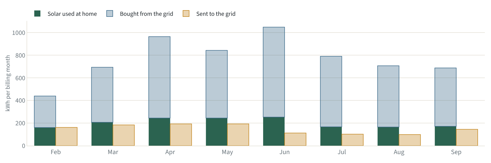

*Each month's household demand (stacked: solar used at home plus electricity bought) beside what was sent back to the grid.*

Solar used at home was steady, at 160 to 253 kWh a month. Demand was not. It rose about 75% per day from February to June (20 to 35 kWh a day) as the air conditioning came on, then eased with the rains. The bills went up because the house used more, not because the panels made less. A 3 kWp system against a 1,000 kWh month is undersized for summer rather than underperforming.

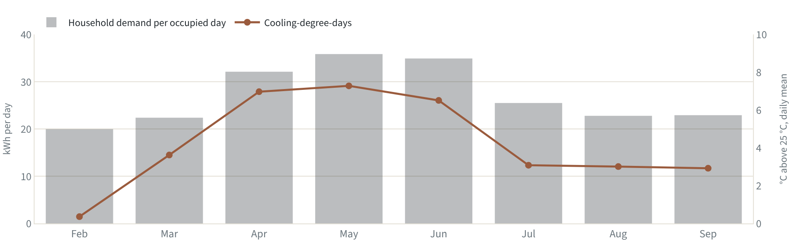

*Household demand per occupied day (bars) and cooling-degree-days (line). May's days are counted net of the week the house stood empty.*

Demand follows the heat. Measured by cooling-degree-days, how far the daily mean temperature sat above 25 °C, the correlation is +0.94. Demand here is counted per occupied day, because the house stood empty for about a week in May, and the family recalls importing roughly 200 fewer units than usual. An absence of 7.5 days reproduces that figure, so May's demand is spread over its occupied days only.

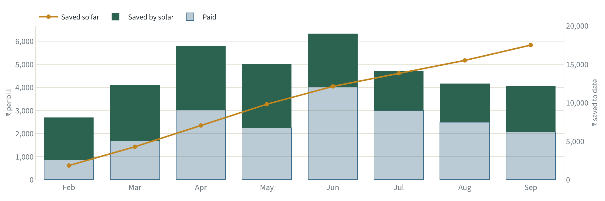

*What each bill cost and what solar saved, slab by slab under net metering, with the running total.*

Under net metering, every exported unit is credited against an imported one, so the bill follows imports minus exports. Comparing each bill with what it would have been without solar, slab by slab at the domestic tariff [7], solar has saved ₹17,487 so far.

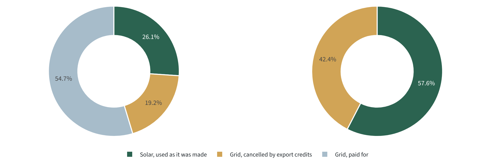

*All eight bills together. Left: bill offset is the green and gold slices together; self-sufficiency is the green slice alone. Right: the same solar, split by where it went.*

Two percentages are easy to confuse, and the left-hand chart shows both. Of all the electricity the house used, 26% came from the panels at the moment they were producing; that green slice is **self-sufficiency**. Another 19% came from the grid but was cancelled on the bill by units the panels had exported earlier; that is the gold slice. Together they make the **bill offset**: generation equal to 45% of household demand. The remaining 55% was bought and paid for. The right-hand chart shows the same solar from the other side: 58% was used at home and 42% went to the grid.

## A cheap experiment: paint the roof white

These panels are bifacial: they collect light on the back as well as the front, from sunlight reflected off the surface below. Today that surface is dark, often damp concrete, which reflects roughly 12% of the light falling on it. White paint reflects about 70%. The module datasheet's rear-gain table runs from 15% to 30% depending on the ground [6], and on the current surface the rear side probably adds about 5%. Our estimate for a white surface is about 12% more light-driven output.

**Would it also keep the panels cooler in summer?** This was worth checking, because heat is what costs these panels most in exactly the months with the highest cooling-degree-days. In a typical year, heat takes 7.4% of output in April, when the cells run about 18 °C above the air, against 2.3% in December.

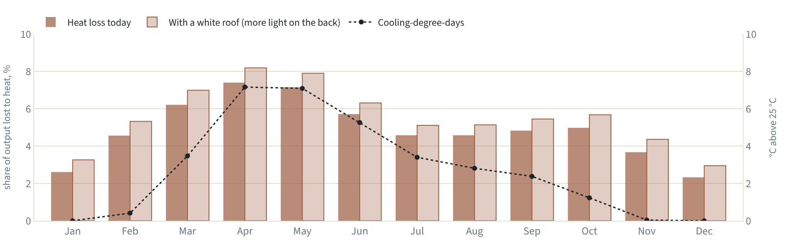

*Share of output lost to panel heat in a typical year, today and with a white roof below, against cooling-degree-days. Hover for how far the cells run above the air.*

Probably not, though the evidence here is thinner than for the light gain. Two effects pull in opposite directions.

- **The back of the panel gets hotter.** Reflected light that reaches the back is absorbed, and absorbed light that does not become electricity becomes heat. With bifaciality of 80% [6], a 12% output gain means about 15% more light landing on the module. In our model, which applies the NOCT relation to that extra light, the cells run about 2.6 °C warmer in April and the heat loss rises from 7.4% to 8.2%. This is a model result, not a measurement.
- **The surroundings get cooler.** A white roof stays cooler in the sun [8], so it radiates less heat at the panels and warms the air around them less. Over a cool-roof coating, monofacial panels, which cannot use the reflected light and so show only this effect, ran 1.3 °C cooler [9].

So at the summer peak the cells end up between 1.3 °C warmer (if the cooling measured on another roof applies here) and 2.6 °C warmer (if it does not). We found no published test that measures bifacial cell temperature over a dark roof and a white one side by side. What the field tests agree on is that the energy gain from a reflective roof comes mostly from extra light, not from lower temperatures [10, 8], and the bifacial gain is much larger than the monofacial one [9]. For this array the paint boosts the light. It is not a coolant.

The heat costs between 16 and 37 kWh a year, depending on which bound holds. Either way that is small next to the 550 kWh of extra light.

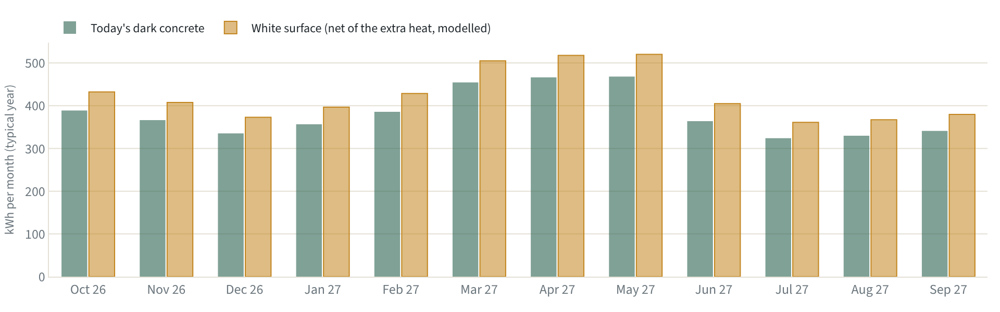

*Typical-year generation with today's dark concrete and with a white surface beneath the panels, after subtracting the extra heat. Modelled from the module datasheet, not measured on this roof.*

Net of that heat, a white surface adds 513 to 534 kWh in a typical year (we use the lower figure), roughly 11%, worth up to ₹3,300 a year at the top tariff slab of ₹6.34 per unit [7]. Winter units fall in cheaper slabs, so treat that as a ceiling. On ₹8,000 to ₹12,000 of paint and labour, the payback is roughly 2.5 to 3.7 years. Paint on the parts of the roof not covered by panels could also keep the rooms below a little cooler in summer [8], but we have no data to put a number on that for this house.

## The sky is getting darker

The last hunch came from a longer view. If sunlight drives everything, is the sunlight itself changing? NASA's record for these coordinates goes back to 1984.

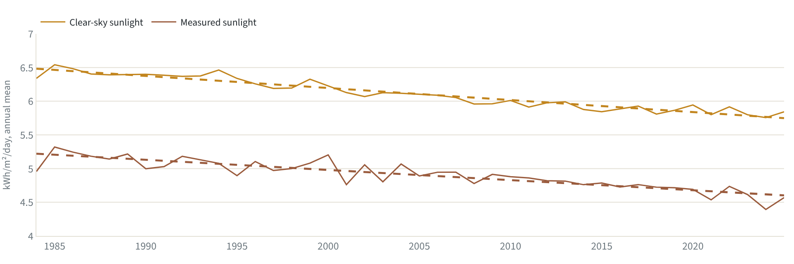

*Annual mean sunlight at these coordinates, 1984–2025: what reached the ground (measured) and what would on a cloudless day (clear-sky). Dashed: trends.*

Average sunlight fell from 5.14 kWh/m² per day in 1984–93 to 4.65 in 2016–25, a decline of −0.15 per decade (p < 0.0001). Ground stations have recorded the same dimming across India for decades [11, 12]. The natural suspect is cloud. But at these coordinates the clear-sky series, the sunlight a cloudless day would deliver, fell even faster, at −0.18 per decade.

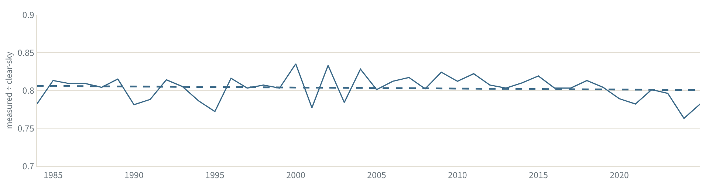

*Clearness index, measured ÷ clear-sky. Flat means cloud cover has not changed.*

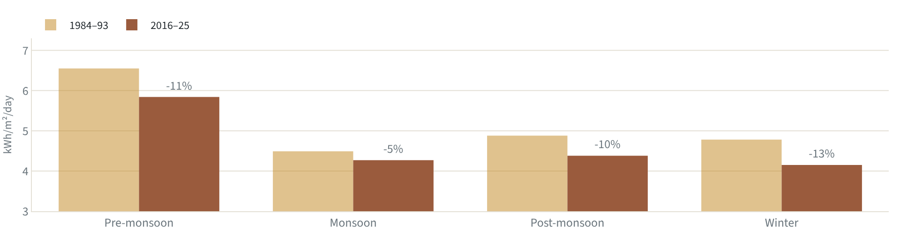

*Seasonal sunlight in the first and the latest decade of the record.*

The clearness index, measured sunlight divided by clear-sky sunlight, is flat (−0.001 per decade, p = 0.53). Over this grid cell, cloud cover has not changed; the air itself has become less transparent. That fits a 2024 study that found clouds dominate dimming across India as a whole, but named the region containing Bhubaneswar as the country's most aerosol-affected [13]. The dry seasons lost the most here, and those are the months in which a rooftop array earns most of its keep.

The same NASA record shows daily maximum temperatures falling, while India's own station network shows them rising [14]. We treat that as an artefact of the dataset and build nothing on it.

## Over the panels' life

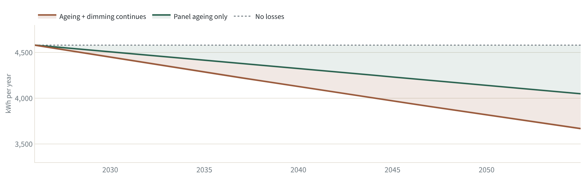

*Annual output over the panels' 30-year power warranty. Ageing follows the datasheet warranty line; dimming extrapolates the 42-year trend, a downside case rather than a forecast.*

Two slow losses compound. The panels age: the datasheet warrants at least 99% of rated power after the first year and 87.4% after 30 years, about 0.4% a year [6]. And if the dimming trend continues at 0.32% a year, sunlight falls further over the same period. By 2055 the array would make about 3,668 kWh, 20% below year one, about 8 percentage points worse than ageing alone. Aerosol pollution is a policy choice rather than a law of nature. Europe has brightened since the 1980s as air pollution was cut [15, 16], and eastern China has brightened since its 2013 Clean Air Action [17], after decades in which pollution had measurably cut solar output [18]. The lower line is a downside case, not a forecast.

## How we worked

- **Data.** Eight TPCODL bills, 8 February 2026 to 1 October 2026, reconciled against cumulative meter readings. NASA POWER daily weather for the billed days, ten years of daily history (2016 to 2025), and the monthly and annual record back to 1984 [1].
- **Model one, for forecasting.** Generation per day = a × sunlight + b, fitted by least squares on the eight months.
- **Model two, for diagnosis and the typical-year forecast.** Sunlight on the panels × heat derate × kWp × η, with η the only fitted number.
- **Validation.** One genuine out-of-sample month (September) and leave-one-out across all eight.
- **Assumptions.** Panels fixed at 12° facing south. Ground reflectivity 0.12. Cell temperature from a NOCT of 43 °C. Tariff slabs of ₹2.90, 4.70, 5.70 and 6.10 per unit plus 4% duty. The house empty for 7.5 days in May (demand only). White-surface gain of 12% from the datasheet's rear-gain table.
- **Limits.** Eight monthly points. An efficiency fitted on the same months it judges. Satellite estimates for a grid cell rather than a sensor on the roof. No inverter-level data.

Every number and chart in this piece is regenerated from the project's data with a single command.

## Sources

1. NASA Langley Research Center, POWER Project. Data methodology: solar data from CERES SYN1deg and FLASHFlux at 1° × 1°; meteorology from MERRA-2 at ½° × ⅝°. https://power.larc.nasa.gov/docs/methodology/
2. Erbs, D. G., Klein, S. A. & Duffie, J. A. (1982). Estimation of the diffuse radiation fraction for hourly, daily and monthly-average global radiation. Solar Energy 28(4), 293–302. doi:10.1016/0038-092X(82)90302-4 https://doi.org/10.1016/0038-092X(82)90302-4
3. Anderson, K. S. et al. (2023). pvlib python: 2023 project update. Journal of Open Source Software 8(92), 5994 (solar position and Ineichen clear-sky model used here). https://doi.org/10.21105/joss.05994
4. Duffie, J. A. & Beckman, W. A. (2013). Solar Engineering of Thermal Processes, 4th ed. Wiley (extraterrestrial radiation, beam tilt factor, NOCT cell-temperature model). https://doi.org/10.1002/9781118671603
5. Liu, B. Y. H. & Jordan, R. C. (1963). The long-term average performance of flat-plate solar-energy collectors. Solar Energy 7(2), 53–74 (isotropic-sky model for diffuse light on a tilted surface). https://doi.org/10.1016/0038-092X(63)90006-9
6. Waaree Energies. Elite Series N-type BiN-01-555 to BiN-01-585 framed dual-glass bifacial module datasheet (WEL/E&PD/555-585/108/BiN-01/HC/02, 03.01.2025): γ = −0.30 %/°C, NOCT 43 ± 2 °C, bifaciality 80 ± 10 %, backside gain table 15–30 %, 30-year power warranty (99 % after year 1, 87.4 % after year 30). https://rooftopsolarindia.com/datasheet/waaree-energies/datasheet-waaree-elite-n-type-bifacial-555W-560W-565W-570W-575W-580W-585W.pdf
7. Kalinga TV (24 March 2025). No power tariff hike in Odisha for 2025-26: domestic energy charges ₹2.90 (0–50 units), ₹4.70 (51–200), ₹5.70 (201–400), ₹6.10 (above 400). The same slabs appear on the TPCODL bills. https://kalingatv.com/odisha/no-power-tariff-hike-in-odisha-for-2025-26-check-details-rebate-for-e-bill/
8. Experimental energy performance assessment of a bifacial photovoltaic system and effect of cool roof coating. Journal of Building Engineering (2023); summarised in pv magazine, 17 November 2023: bifacial + cool roof +8.6 % vs monofacial; unshaded roof surface −3.8 °C in summer (Barcelona test bench). https://www.pv-magazine.com/2023/11/17/lowering-bifacial-rooftop-pv-system-temperature-with-cool-roof-coating/
9. Mahmood, K., Hussain, A., Arslan, M. & Tariq, B. (2023). Experimental investigation of impact of cool roof coating on bifacial and monofacial photovoltaic modules. Engineering Proceedings 45(1), 38. doi:10.3390/engproc2023045038 https://doi.org/10.3390/engproc2023045038
10. Altan, H. et al. (2019). An experimental study of the impact of cool roof on solar PV electricity generations on building rooftops in Sharjah, UAE. International Journal of Low-Carbon Technologies 14(2), 267–276. https://academic.oup.com/ijlct/article/14/2/267/5307064
11. Padma Kumari, B. et al. (2007). Observational evidence of solar dimming: Offsetting surface warming over India. Geophysical Research Letters. doi:10.1029/2007GL031133 https://doi.org/10.1029/2007GL031133
12. Soni, V. K., Pandithurai, G. & Pai, D. S. (2012). Evaluation of long-term changes of solar radiation in India. International Journal of Climatology. doi:10.1002/joc.2294 https://doi.org/10.1002/joc.2294
13. Jadhav, A. V., Rahul, P. R. C., Kumar, V., Dumka, U. C. & Bhawar, R. L. (2024). Spatiotemporal assessment of surface solar dimming in India: impacts of multi-level clouds and atmospheric aerosols. Climate 12(4), 48. doi:10.3390/cli12040048 https://doi.org/10.3390/cli12040048
14. Kumar, R., Kuttippurath, J., Gopikrishnan, G. S., Kumar, P. & Varikoden, H. (2023). Enhanced surface temperature over India during 1980–2020 and future projections: causal links of the drivers and trends. npj Climate and Atmospheric Science 6, 164 (IMD gridded data: maximum temperature rising 0.14–0.21 °C per decade). https://www.nature.com/articles/s41612-023-00494-0
15. Wild, M. et al. (2005). From dimming to brightening: decadal changes in solar radiation at Earth's surface. Science 308, 847–850. doi:10.1126/science.1103215 https://doi.org/10.1126/science.1103215
16. Wild, M. (2009). Global dimming and brightening: a review. Journal of Geophysical Research 114, D00D16. doi:10.1029/2008JD011470 https://doi.org/10.1029/2008JD011470
17. Shi, H. et al. (2021). Surface brightening in eastern and central China since the implementation of the Clean Air Action in 2013: causes and implications. Geophysical Research Letters. doi:10.1029/2020GL091105 https://doi.org/10.1029/2020GL091105
18. Sweerts, B. et al. (2019). Estimation of losses in solar energy production from air pollution in China since 1960 using surface radiation data. Nature Energy. doi:10.1038/s41560-019-0412-4 https://doi.org/10.1038/s41560-019-0412-4
