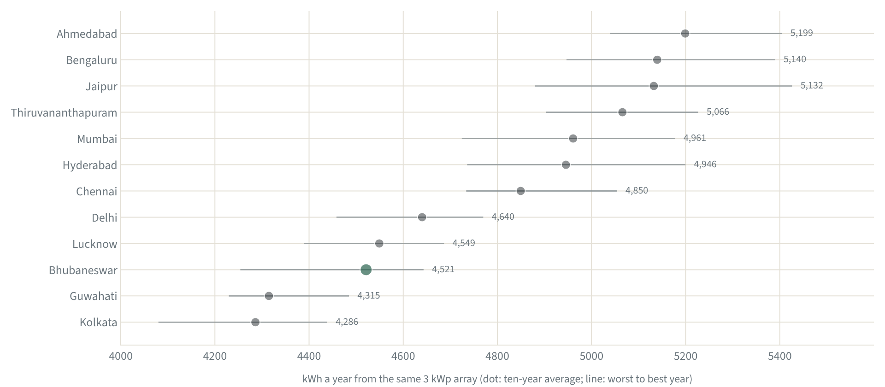
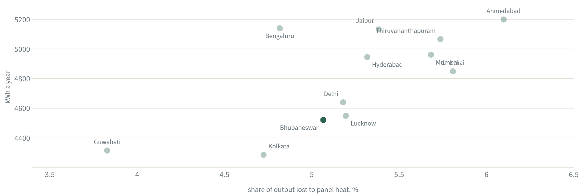
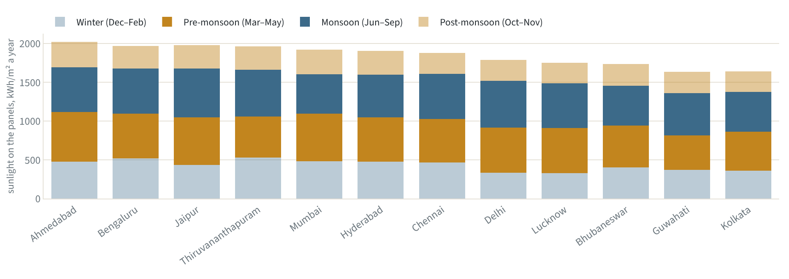
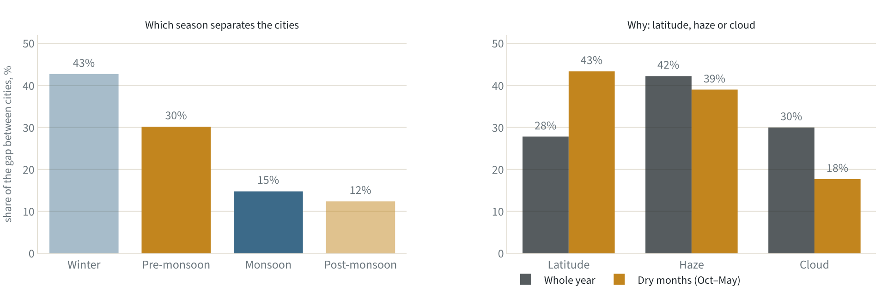
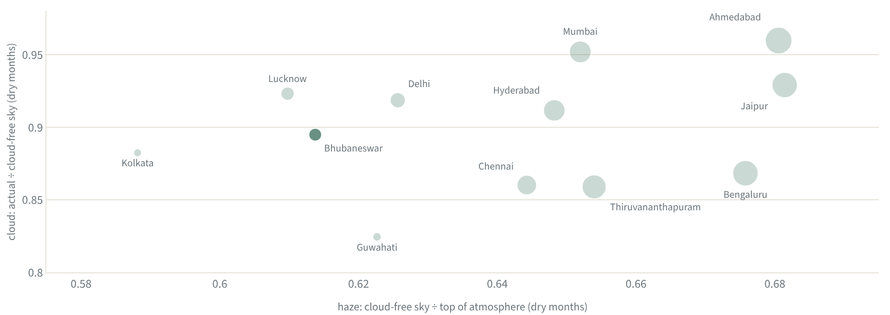

# Same roof, twelve cities

*We ran one 3 kWp rooftop array through ten years of weather in twelve Indian cities to ask what really decides how much it makes: monsoon cloud or summer heat. The answer was neither.*

By Piyush Dash · November 2026

Our [first article](https://piyushdash94.github.io/rooftop-solar-analytics/) followed one bifacial array on a roof in Bhubaneswar, using nine months of bills. It left us wondering how ordinary that roof is. Would the same panels make more in Jaipur, or less in Kolkata? And if they would, why?

The obvious guesses are the two things everyone talks about in India: the monsoon, which buries the sky under cloud for four months, and the summer heat, which makes solar panels less efficient. We wrote down a hypothesis before running anything.

## The hunch, written down first

**Hypothesis.** Across Indian cities, monsoon cloud decides rooftop yield far more than summer heat.

We set three tests and the bar each had to clear, before looking at any results.

| Test | What would support the hypothesis |
|---|---|
| (a) Sun or heat | The spread across cities in sunlight on the panels is at least twice the spread caused by heat. |
| (b) The monsoon's share | June to September explains more than half of the difference in annual panel sunlight between cities. |
| (c) Ranking | A city's output ranks more closely with its monsoon sunlight than with its heat loss. |

## How we ran it

We kept everything about the array fixed and changed only the weather. Same 3 kWp of bifacial panels, same 12° tilt facing south, same dark concrete underneath, and the same system efficiency of 0.913 that we fitted to the Bhubaneswar bills. For each city we downloaded ten years of daily NASA POWER satellite weather, 2016 to 2025 [1], and ran it through the physics model from the first article: sunlight on the panel plane, a heat correction from the module's datasheet [2], then kilowatt-hours.

Two checks before trusting it. Our fresh download for Bhubaneswar gives 4,521 kWh a year, within 0.1% of the 4,518 kWh typical year in the first article, which was calibrated on real bills. And the twelve cities average 4.4 kWh per kWp a day, inside the 3.5 to 4.5 band the World Bank reports for India [3].

One limitation matters. A fixed 12° tilt is close to ideal in the south and a little flat for the north, where the cities sit at up to 28.6° latitude. Tilting every array to its own latitude instead barely changes the order: the two rankings correlate at 0.99.

## The ranking

*The same array, 12° south, dark concrete roof, run through 2016–2025 NASA weather in each city. Dot: ten-year average. Line: worst to best year. Green: Bhubaneswar.*

Ahmedabad comes first at 5,199 kWh a year and Kolkata last at 4,286, a gap of 21% from nothing but weather. Bhubaneswar is 10th of 12. The same panels on a roof in Ahmedabad would make about 15% more.

## Heat is a tax, not a verdict

Test (a) passed easily. The spread in panel sunlight across cities is 7.4%; the spread in the heat factor is 0.6%, about 12 times smaller. Heat costs between 3.8% (Guwahati) and 6.1% (Ahmedabad) of output, and that range is narrow.

*Each dot is a city. Hotter cities lose more to heat, yet they produce more: the sunshine that heats the panels outweighs what the heat takes away.*

The surprise is the direction. The cities that lose most to heat produce the most. Ahmedabad's cells reach about 55 °C in its hottest month, against 42 °C in Guwahati, yet Ahmedabad tops the table. Output and heat loss rank together at +0.64. Heat is a tax on sunshine, and the sunniest cities can most afford it.

## The monsoon is not what separates cities

Tests (b) and (c) failed. June to September explains only 15% of the difference in annual panel sunlight between cities. Output ranks with monsoon sunlight at +0.47, below heat, and far below the dry months, at +0.89.

*Sunlight landing on the panels each season, cities in order of annual output. The monsoon slices are similar; winter and pre-monsoon slices are not.*

*Left: each season's share of the between-city spread in annual panel sunlight. Right: the spread in ground sunlight split into latitude, haze (what a cloud-free sky absorbs and scatters) and cloud.*

The monsoon dims every city, but it dims them by similar amounts, so it does little to change their order. Delhi has the 2nd brightest monsoon of the twelve and still finishes 8th. The difference is made in winter, which explains 43% of the gap, and the pre-monsoon months, which explain 30%. Bhubaneswar's panels collect 402 kWh/m² from December to February; Bengaluru's collect 517, 29% more.

So the hypothesis, as written, is rejected. One of its three tests held.

## Haze, more than cloud

If the dry season decides, what decides the dry season? Sunlight can be lost in three places on the way down. Latitude sets how much arrives at the top of the atmosphere. The air itself scatters and absorbs some, even with no cloud in sight: dust, smoke, pollution and water vapour. Clouds take the rest. NASA's data gives all three: sunlight at the top of the atmosphere, sunlight under a cloud-free sky, and sunlight that actually arrived. Their ratios split the gap between cities into latitude, haze and cloud.

Over the whole year, haze explains 42% of the gap in ground sunlight, cloud 30% and latitude 28%. In the dry months cloud falls to 18%, and haze (39%) and latitude (43%) do almost all the work.

*Dry-season sky in each city. Further right: clearer cloud-free air. Higher: fewer clouds. Bubble size: annual output.*

The haziest dry-season skies belong to Kolkata, Lucknow, Bhubaneswar, Guwahati and Delhi, the eastern cities and the Indo-Gangetic Plain. A cloud-free sky over these cities lets through as little as 0.59 of the sunlight arriving at the top of the atmosphere, against up to 0.68 over the clearest. Bhubaneswar's figure is 0.61. This fits what field studies have found. Particles in the air and dust settled on the glass each cut solar output in India by similar amounts [4], and aerosols during winter fog over the Indo-Gangetic Plain reduced surface sunlight by 5 to 35% in one detailed case study [5]. It also fits the first article, where Bhubaneswar's 42-year decline in sunlight was in the cloud-free sky, not in cloudiness.

## A new hypothesis

The data points to a different story from the one we started with. **Winter air clarity, not the monsoon or the heat, is what separates Indian cities for rooftop solar.** That is a new claim, found in the data rather than tested on it, so it needs its own test. The natural one is independent: aerosol measurements from a different satellite instrument should rank the twelve cities' winter skies the same way NASA's clear-sky ratio does.

Two smaller results are worth recording. Output is steady from year to year everywhere: its coefficient of variation is 1.8 to 3.1%. And the cities that lean hardest on the monsoon are not the ones whose output swings most (rank correlation −0.29).

## How we worked

- **Data.** NASA POWER daily point data for each city centre, 2016 to 2025. Sunlight comes from CERES satellite products at 1° resolution, so each "city" is really a 100 km grid cell.
- **Model.** The physics model from the first article: daily diffuse split, sunlight on a 12° south-facing plane, NOCT cell temperature, one efficiency of 0.913 fitted on Bhubaneswar's bills and applied everywhere.
- **Tests.** Three criteria written before running. Spreads are standard deviations of logarithms, so they read as percentages. Season and haze shares are covariance shares, which add up to 100%.
- **Limits.** Twelve cities. The same tilt, roof and efficiency everywhere. Dust that settles on the panels is not modelled, and it can be as large a loss as dust in the air [4]. No tariffs or money: this is about kilowatt-hours only.

## Sources

1. NASA Langley Research Center, POWER Project. Data methodology: solar data from CERES SYN1deg and FLASHFlux at 1° × 1°; meteorology from MERRA-2 at ½° × ⅝°. https://power.larc.nasa.gov/docs/methodology/
2. Waaree Energies. Elite Series N-type BiN-01-555 to BiN-01-585 framed dual-glass bifacial module datasheet (WEL/E&PD/555-585/108/BiN-01/HC/02, 03.01.2025): γ = −0.30 %/°C, NOCT 43 ± 2 °C, bifaciality 80 ± 10 %, backside gain table 15–30 %, 30-year power warranty (99 % after year 1, 87.4 % after year 30). https://rooftopsolarindia.com/datasheet/waaree-energies/datasheet-waaree-elite-n-type-bifacial-555W-560W-565W-570W-575W-580W-585W.pdf
3. World Bank / ESMAP and Solargis (2020). Global Photovoltaic Power Potential by Country. PVOUT assumes fixed, optimally tilted monofacial c-Si, 3.5% soiling and 7.5% other losses. https://documents1.worldbank.org/curated/en/466331592817725242/pdf/Global-Photovoltaic-Power-Potential-by-Country.pdf
4. Bergin, M. H., Ghoroi, C., Dixit, D., Schauer, J. J. and Shindell, D. T. (2017). Large reductions in solar energy production due to dust and particulate air pollution. Environmental Science & Technology Letters 4, 339–344. doi:10.1021/acs.estlett.7b00197 https://pubs.acs.org/doi/10.1021/acs.estlett.7b00197
5. Bharali, C., Barth, M., Kumar, R., Ghude, S. D., Sinha, V. and Sinha, B. (2024). Role of atmospheric aerosols in severe winter fog over the Indo-Gangetic Plain of India: a case study. Atmospheric Chemistry and Physics 24, 6635–6662. https://acp.copernicus.org/articles/24/6635/2024/
